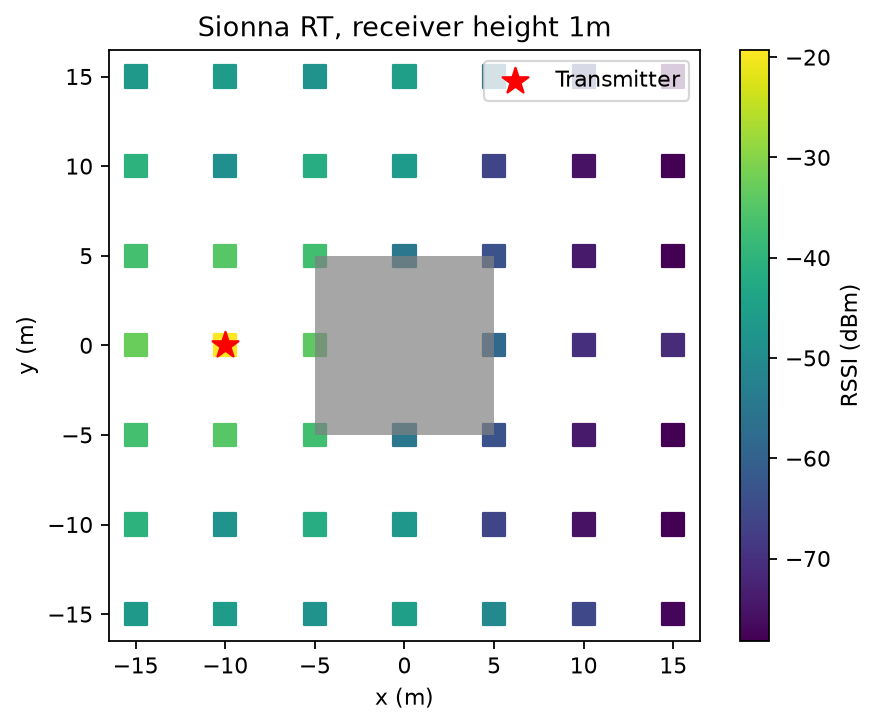

# AI_project — радіоканал і Husky у готових симуляторах

Робоче Python-застосування використовує **NVIDIA Sionna RT 2.2.0** для
радіофізики. **Gazebo Harmonic / ROS 2 Jazzy / Clearpath Simulator** забезпечують
світ і Husky A200. Тут немає власного розв'язувача електромагнітних хвиль.

## Перевірити радіоканал без ROS і Docker

Python 3.12 і системна LLVM-бібліотека потрібні для CPU-бекенду Dr.Jit.
На Ubuntu 24.04: `sudo apt install python3-venv libllvm18 libatomic1`;
на Debian 13: `sudo apt install python3-venv libllvm19 libatomic1`.

```bash
bash scripts/setup_radio.sh
.venv/bin/python app/radio.py sample -10 10 1
.venv/bin/python app/radio.py trajectory config/trajectory.json /tmp/radio-results.jsonl
.venv/bin/python app/radio.py map /tmp/radio-map.png --step 5
.venv/bin/python -m unittest discover -s tests -v
```

`sample` повертає RSSI, SNR, кількість шляхів, комплексні коефіцієнти CIR
та абсолютні затримки. `trajectory` обчислює ці величини для кожної точки
й записує JSONL. `map` зберігає PNG-карту з обчисленими значеннями RSSI
та контурами будівель; роздільність задається `--step` у метрах. Відсутність знайдених шляхів позначається `rssi_dbm: null`.

Для HTTP запустіть у першому терміналі:

```bash
.venv/bin/python app/radio.py serve --port 8010
```

У другому:

```bash
python scripts/check_api.py
curl -s http://127.0.0.1:8010/sample \
  -H 'Content-Type: application/json' -d '{"position_m":[10,0,1]}'
```



## Запустити Gazebo, Husky й ROS-радіоканал

Потрібні Linux x86_64, Docker Engine з Compose, Python/LLVM як вище та доступ
до PyPI, Docker Hub і ROS/Ubuntu репозиторіїв. Перша збірка завантажує кілька ГБ.

```bash
bash scripts/run_demo.sh
python scripts/check_api.py
docker compose exec husky bash -lc \
  'source /opt/ros/jazzy/setup.bash; python3 scripts/check_husky.py'
```

Другий check на 5 секунд рухає симульований Husky, перевіряє зміну odometry
та надходження ненульових радіовимірювань. Виконуйте його у демонстраційному
світі. Запуск headless; команди для огляду й дебагу:

```bash
docker compose logs -f husky
docker compose exec husky bash
# У контейнері:
source /opt/ros/jazzy/setup.bash
ros2 topic list
ros2 topic echo /radio/measurement std_msgs/msg/String
```

Зупинка: `docker compose down`. Нова геометрія:
змінити `config/world.json`, виконати `bash scripts/prepare_world.sh`,
потім `docker compose restart radio husky`.
Якщо використовується наявний virtualenv, передайте `RADIO_VENV=/path/to/venv`.

За наявності корпоративного TLS-проксі передайте довірений CA bundle:
`RADIO_CA_BUNDLE=/path/to/ca-bundle.pem bash scripts/run_demo.sh`.
Перевірка TLS залишається увімкненою. Хмарний Docker cache за потреби:
`BUILDX_CONFIG=/workspace/.cache/buildx`.

## Будівлі та модель

`config/world.json` задає одну геометрію для обох движків: кожна будівля
має `center: [x,y,z]`, `size: [width,depth,height]`, ITU-матеріал і
`thickness_m` радіоматеріалу. Координати й розміри — метри; частота — Гц;
потужність — dBm. Земля теж описана прямокутним об'єктом. Генератор
`export-gazebo` переносить ці коробки у SDF, а `Radio` — у Mitsuba mesh.
Це конвертація геометрії, а не власна фізична модель.

Увімкнені відбиття, заломлення й дифракція Sionna. Комплексні коефіцієнти
когерентно складаються для вузькосмугового RSSI, тому враховується інтерференція
шляхів одного передавача. SNR використовує тепловий шум, bandwidth і noise figure.
Кількість семплів/глибину трасування можна змінити у `solver`. Більші значення
збільшують обчислення; точність потребує перевірки збіжності й калібрування.

ROS-адаптер `app/ros_radio.py` читає odometry, викликає HTTP сервіс та публікує
JSON у `/radio/measurement`. Для демонстрації local odom перетворюється
постійним зміщенням старту `[-10,10]`; для довільного світу/реального Husky
потрібне узгодження з TF/map. Робот не включений у радіогеометрію.

Немає PHY конкретного модема, packet loss/latency моделі, сторонніх
передавачів, Nav2, GPR чи автоматичного відновлення зв'язку. Ray tracing
не гарантує точності повнохвильового розв'язку для всіх ефектів.
Графічний Gazebo потребує локального дисплея; браузерний робочий стіл
не реалізований. Докладніше: [стек та стан перевірок](docs/simulation-stack.md).

Для графічного запуску на локальній Ubuntu з установленим Clearpath/Gazebo
та робочим дисплеєм (це не браузерний доступ до хмарної машини):

```bash
source /opt/ros/jazzy/setup.bash
bash scripts/prepare_world.sh
mkdir -p /tmp/clearpath
cp config/robot.yaml /tmp/clearpath/robot.yaml
ros2 launch "$PWD/launch/husky.launch.py" \
  world_file:="$PWD/.runtime/world.sdf" setup_path:=/tmp/clearpath gz_args:="-r"
```
