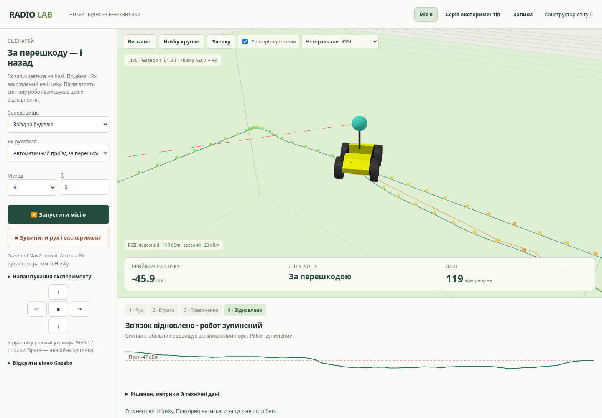
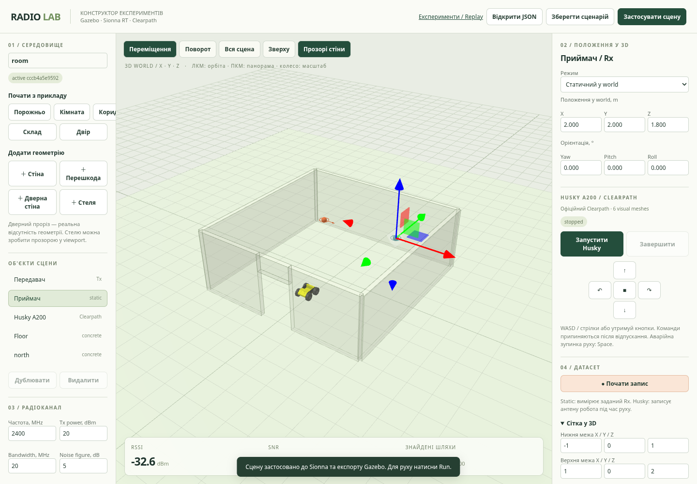

# Radio Lab — 3D-конструктор радіоекспериментів із Husky

Побудуйте приміщення, розмістіть Tx/Rx у 3D, запустіть класичний
**Husky A200 Clearpath** та зберіть датасет. Радіофізику обчислює
**NVIDIA Sionna RT 2.2.0**, рух/зіткнення — **Gazebo Harmonic / ROS 2 Jazzy**.
Frontend — Three.js; власного розв'язувача радіохвиль немає.

**[Повний гайд для презентації: як усе працює і що показати](docs/PRESENTATION_GUIDE.md)**
та окремо **[весь наявний функціонал, API й обмеження](docs/FEATURE_CATALOG.md)**.

## Запуск

Linux x86_64, Python 3.12/venv + LLVM/libatomic, Node.js 20.19+ або 22.12+,
Docker Engine + Compose v2. Потрібен вільний диск для кількох ГБ ROS-залежностей.
Повна інсталяція і мережеві prerequisites — [USER_GUIDE](docs/USER_GUIDE.md).

```bash
bash scripts/run_demo.sh --start
```

Для демонстрації відкрийте **http://127.0.0.1:8010/experiments.html**.
З `--start` підготовка GPR-місії починається автоматично; 3D-карта RSSI
вже увімкнена. Без цього прапорця запуск виконує кнопка **▶ Запустити місію**.
Gazebo, Husky, Nav2, радіоканал і запис готуються разом.
Tx стоїть на базі; Rx їде на Husky в напрямку перевіреної радіотіні,
після чого робот автономно повертається до зв’язку.

Швидкий режим гальмує на першому слабкому показі, підтверджує втрату за
0.5 s і перевіряє фактичну зупинку перед поверненням. Карта має збільшені
масштаб/чутливість і повноекранний перегляд.
[Пороги, очікування, помилки й порівняння протоколів](docs/LINK_PROTOCOL.md).

**[Покрокова демонстрація й керування](docs/DEMONSTRATION.md)** ·
**[Серії 100+, математичні оцінки та ітерації](docs/QUALITY.md)**.

**Навчання й результати GPR:** відкрийте **http://127.0.0.1:8010/research.html**
або **Модель і перевірки** у меню. Криві навчання за записаними показами,
незалежний test, успішні/невдалі проїзди та повторні перевірки доступні без
імпорту ZIP. [Як читати результати й демонструвати модель](docs/MODEL_EVIDENCE.md).
Це дані симуляції; польової перевірки на фізичному Husky ще немає.
У live/replay є **3D карта сигналу**: об’ємна поверхня RSSI над місцевістю.
У звіті доступна повна GPR-місія з цією картою, без повторного запуску Gazebo.

Готові дані: **[150 фізичних повернень, 7 356 reference-позицій, відео й звіти](examples/experiments/shadow-benchmark/README.md)**.
Базова серія: 98/100; після виправлення обходу кута Nav2 — 30/30 в окремій
перевірці. Попередні невдачі збережені. Це результати симуляції на 10 RF-полях.



Для власної геометрії: **http://127.0.0.1:8010/** — конструктор,
збереження/імпорт JSON, Tx/Rx у 3D, ручне керування, recording/grid.
Для вікна самого Gazebo на Linux desktop після старту місії:
`bash scripts/gazebo_gui.sh`.

Повторний запуск без оновлення коду, якщо образи вже побудовані:

```bash
docker compose up -d --no-build
```

Після оновлення коду виконайте `bash scripts/run_demo.sh`:
він збирає frontend/images і перезапускає сервіси. Docker tags локальні;
вхід у Docker Hub для `ai-project-radio` / `ai-project-husky` не потрібний.



## Що працює

- 3D viewport, gizmo/числові координати, повернуті стіни, реальний дверний проріз,
  матеріали, Save/Load JSON і п'ять шаблонів, включно зі складом/двором.
- Статичний 3D Rx або антена на Husky із full rigid transform.
- Один shared scenario для Three.js, Mitsuba/Sionna та Gazebo SDF.
- Офіційні Husky visual meshes у браузері й physical model/controllers у Gazebo.
- Run/Stop, ручне керування, world pose, RSSI/SNR/CIR, async grid/recording.
- Датасет: CSV, JSONL, snapshot сцени, manifest/версії/units, events і ZIP.
- Upstream Nav2: occupancy зі спільної сцени, автономні цілі, статичний об'їзд,
  ground-truth localization, арбітраж teleop/Nav2 та cancel/hold.
- Режими деградації/відновлення RSSI, B0/B1/IDW/GPR-zero/GPR-pathloss, μ−βσ.
- Live/replay: карти, невизначеність, часовий RSSI, траєкторія/ціль/маршрут,
  збережені рішення й окремий ZIP експерименту.
- П’ять сімейств світів × два Tx, перевірені цілі радіотіні й фізичні маршрути.
- Серії 100+ повних місій або парних повернень, 1–4 ізольовані воркери,
  warm reset Gazebo/RF, прогрес/продовження та ZIP усіх результатів.
- Reports CSV/JSON: усі невдачі, Wilson95, парні різниці часу/шляху,
  близькість до відомих точок, causal MAE/RMSE за просторовою відстанню,
  spatial holdout NLPD/coverage. Нові та повторені seed-покази рахуються окремо.

Радіомодель: coherent narrowband multipath із reflection/refraction/diffraction.
SNR — synthetic thermal noise model. Не моделюються modem PHY/packet loss,
протокольні затримки, RF-вплив корпусу Husky чи інші передавачі.
Recovery використовує RSSI proxy, статичні перешкоди й Gazebo ground truth;
це не перевірка пакетного зв'язку, SLAM або динамічного об'їзду.
Матеріали/бюджет трасування потребують калібрування й convergence checks;
працездатність не означає full-wave або real-world accuracy.

## Документація для наступного учасника

- [Керування конструктором](docs/USER_GUIDE.md)
- [Збір, формат і аналіз датасету](docs/DATASET_GUIDE.md)
- [Архітектура, API, координати та дебаг](docs/TECHNICAL.md)
- [Передача проєкту](docs/HANDOFF.md)
- [Наступна задача: зібрати датасет](docs/DATA_COLLECTION_TASK.md)
- [План автономних експериментів, карт і демонстрації](docs/EXPERIMENT_PLAN.md)
- [Демонстрація та керування](docs/DEMONSTRATION.md)
- [Якість, серії експериментів та методика оцінювання](docs/QUALITY.md)
- [Додаткові параметри автономних експериментів](docs/EXPERIMENT_GUIDE.md)
- [Формат експерименту, часові події та новий API](docs/EXPERIMENT_FORMAT.md)
- [Готові результати, ZIP і графік для демонстрації](examples/experiments/README.md)
- [Перевірений стан і обмеження середовища](docs/simulation-stack.md)

Сценарії/дані у `.runtime/` не входять у Git. Передавайте свої JSON/ZIP окремо.
Приклади результатів перевірки — `examples/datasets/`.

## Перевірки

На запущеному конструкторі, послідовно, без власного активного датасету:

```bash
.venv/bin/python -m unittest discover -s tests -v
python scripts/check_api.py
python scripts/check_constructor_integration.py
python3 scripts/check_navigation_experiments.py
python3 scripts/check_reset.py
.venv/bin/python scripts/validate_missions.py
npm --prefix frontend run test:e2e
```

Інтеграційний тест застосовує demo room, запускає/рухає симульований Husky,
записує вимірювання та перевіряє world pose/mount/CSV/JSONL/ZIP.
Browser test редагує Rx.Z, збирає сітку на двох висотах і завантажує ZIP.
Navigation check реально об'їжджає перешкоду, відхиляє solid goal, виконує
B1 recovery та перевіряє causal timeline/ZIP. Browser tests перевіряють
3D replay з реальною моделлю Husky, mounted Rx та повний запуск місії однією кнопкою.
Для replay потрібен завершений фізичний проїзд; спочатку виконати navigation check.
Для нього потрібен Chromium; default `/usr/bin/chromium`, можна задати
`PLAYWRIGHT_CHROMIUM_PATH`. Tests змінюють demo active scene.

## Радіочастина без Docker

Для static Rx/grid не потрібен робот:

```bash
bash scripts/setup_constructor.sh
.venv/bin/python app/builder.py --port 8010
```

Без husky service браузер повідомить про відсутні official visual assets
і покаже габаритну рамку. Radio/grid лишаються доступними.
Legacy CLI також збережений:

```bash
bash scripts/setup_radio.sh
.venv/bin/python app/radio.py --config config/room.json sample 2 2 1.2
```

## Логи і зупинка

```bash
docker compose logs -f radio husky
tail -n 100 .runtime/husky.log
docker compose down
```

Stop конструктора завершує Gazebo й активний запис. Stop місії зупиняє
експеримент і рух, зберігаючи прогрітий симулятор. Закриття браузера не завершує весь стек.
Хмарна публікація не зберігає живі процеси: перевірте images і перезапустіть.
