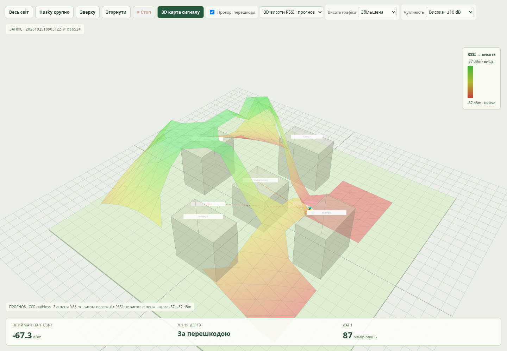

# Реакція на RSSI та запуск із 3D-картою

## Запустити все однією командою

Після `git pull --ff-only`, з кореня репозиторію:

```bash
bash scripts/run_demo.sh --start
```

Команда збирає frontend/образи, запускає сервіси, дочікується API й подає
один запит на підготовку повної місії GPR-pathloss, β=1, з швидкою реакцією.
Відкрийте URL, надрукований у терміналі:
**http://127.0.0.1:8010/experiments.html?method=GPR-pathloss&beta=1&layer=height**.
Повторно кнопку запуску натискати не потрібно. Помилка підготовки відображається
у браузері; запит старту не означає, що Gazebo/Nav2 вже готові.

Якщо сервіси вже запущені, без нового build:

```bash
python3 scripts/start_demo.py
# Або інша місцевість:
python3 scripts/start_demo.py --mission office
```

Активна місія не перезаписується: спочатку натисніть **Стоп**. Звичайний
`bash scripts/run_demo.sh` запускає лише сервіси; місію запускає кнопка в UI.
Відкриття сторінки саме по собі не запускає робот. Карта RSSI увімкнена
за замовчуванням і з’являється після перших показів та fit моделі.

Скрипт спочатку чекає HTTP API **Radio**, потім HTTP API **Husky**, у межах
спільного ліміту 120 s. Скинуте/закрите з’єднання, HTTP-помилка, неповний
JSON чи відповідь ще не готового сервісу під час цих GET-перевірок повторюються.
Повідомлення `Husky API ready` означає готовність supervisor; світ і Nav2
готуються вже після запиту місії. За іншої адреси supervisor можна передати
`--husky-base http://HOST:PORT`; без цього використовується хост Radio на порту 8766.

Якщо початковий `--start` завершився помилкою очікування, після оновлення
скрипта достатньо **`python3 scripts/start_demo.py`**: повторний Docker build
не потрібний. При timeout виведіть `docker compose logs --tail 80 radio husky`.
Ліміт очікування можна задати через `--wait-seconds`.
Запит `POST /api/mission/start` надсилається один раз. Якщо з’єднання
обірвалося вже під час цього запиту, скрипт повідомить про невідомий результат
і попросить перевірити браузер перед повторним стартом.

## Більш виразна карта

- **Висота графіка → Збільшена**: стандартна амплітуда 10 замість 5;
  **Максимальна** дає 16. Це графічний масштаб, не фізичний Z антени.
- **Чутливість → Посилена ±20 dB**: діапазон навколо порога відновлення q.
  За q=−47 dBm це −67…−27 dBm. Поблизу порога зміна на 1 dB дає 0.25
  графічної одиниці висоти замість попередніх 0.0625: вчетверо помітніше.
- **Висока ±10 dB**: за тієї самої амплітуди перепад становить 0.5 на dB,
  увосьмеро більше за старий масштаб. **Повна шкала** повертає −100…−20 dBm.
- **На весь екран** збільшує viewport. **Згорнути** / Esc виходить із нього;
  **Стоп** і Space доступні під час живої місії. У replay кнопка Стоп вимкнена.

Графічна шкала фіксована для вибраного q й чутливості, не підлаштовується
під кожний кадр. Значення поза нею насичуються лише у висоті/кольорі.
Raw RSSI, GPR fit, критерій втрати та записи не змінюються від цих регуляторів.


Фізичний Z антени підписаний окремо; це поверхня RSSI над X/Y, не радіополе
на всіх фізичних висотах одночасно.

## Швидкий протокол втрати

Стандартні значення UI/API місії:

Критерій спирається на симуляційний RSSI; поріг потрібно підбирати під
приймач. Пакетна доставка та PHY у цьому протоколі не моделюються.

| Параметр | Значення |
| --- | ---: |
| Період запиту Sionna | 0.25 sim s |
| Поріг відновлення q | −47 dBm |
| Гістерезис h | 1 dB |
| Слабкий raw показ | RSSI < q − h = −48 dBm |
| Підтвердження втрати | 0.5 sim s і ≥2 різні свіжі слабкі покази |
| Згладжування для підтвердження відновлення | останні 0.5 sim s у лінійній потужності |
| Стабільне відновлення | raw і згладжений RSSI ≥ q протягом 1 sim s |
| Підтверджена зупинка | швидкість кузова <0.03 m/s, yaw rate <0.05 rad/s, ≥0.1 sim s |
| Максимальне очікування гальмування | 4 wall s |
| Очікування неоднозначного сигналу після першого провалу | 2 sim s, не менше заданих degraded/stable |
| Максимальний вік показу | 1.5 sim s |
| Допустиме зміщення від позиції останнього показу | 0.5 m |

Режими й дії:

1. **TELEOP / SURVEY**: рух, прийом RSSI та оновлення карти. Перший raw
   показ нижче −48 dBm викликає `/nav/hold`: чинний Nav2 goal скасовується,
   команди руху обнуляються. Згладжений сигнал не затримує це гальмування.
2. **LINK_SUSPECT**: Husky стоїть/гальмує, нові покази продовжують надходити.
   Якщо слабкий сигнал зберігається 0.5 s та є щонайменше два різні покази,
   втрата підтверджується. Дублі та покази з часом ≤ останнього прийнятого
   не збільшують лічильник. Межа −48…−47 dBm залишає робот у перевірці.
3. Якщо провал минув до підтвердження, потрібен RSSI ≥−47 dBm протягом 1 s
   та підтверджена зупинка. Тоді маршрут/ручне керування відновлюється.
   Одиничний короткий провал не зараховується як підтверджена втрата.
   Якщо значення коливаються чи залишаються в гістерезисному проміжку
   і стабільного відновлення немає, через 2 s робот консервативно повертається.
   Причина записується як `verification_timeout`, окремо від
   `sustained_weak_rssi`; низькі покази не вигадуються. Немає очікування
   глобального timeout 150 s у цьому проміжному стані.
4. **LINK_DEGRADED**: втрата підтверджена; очікуємо реальне гальмування за
   odometry. Новий Nav2 goal не відправляється, доки швидкість не відповідає
   умовам вище. В timeline зберігається подія `brake` з позою, швидкістю,
   часом і зміщенням від першого слабкого показу.
5. **RECOVERY**: за виміряною історією обирається досяжна ціль з добрим
   очікуваним RSSI. GPR використовує μ−βσ; Nav2 будує шлях. Це автономне
   повернення з об’їздом, а не сліпа команда заднього ходу.
6. **RECOVERED_WAIT**: raw і згладжений RSSI стабільно добрі ≥1 s.
   Робот зупиняється, місія завершується успіхом й зберігає метрики.

При точному кроці 0.25 s підтвердження зазвичай використовує три слабкі
покази: t, t+0.25, t+0.5. Рух уже гальмується після першого. У швидкому режимі
**не треба доїжджати до кінцевої точки радіотіні**: вона задає напрямок
дослідження. LoS/NLoS записується як діагностика, а втрата визначається RSSI;
інтерференційний провал навіть за прямої видимості також може спричинити повернення.

Початкова позиція готових швидких місій зміщена на 0.5 m уздовж першого
проїзду від старого spawn, щоб Tx/Rx не стояли майже на одній вертикалі
з нестійким вузькосмуговим провалом. Початкові й наступні RSSI все одно
обчислюються Sionna; контрольні probe-покази не додаються в навчальну історію.

## Що відбувається при помилках

`RSSI=null` від успішного Sionna-розрахунку без знайдених шляхів — валідне
спостереження відсутності сигналу. Воно запускає перевірку слабкого зв’язку.
Виняток розв’язувача, невалідний результат чи відсутність свіжих даних —
помилка спостереження, а не підставлений низький RSSI.

Помилка розрахунку, вік показу >1.5 s або переміщення >0.5 m від його позиції
завершують місію як **FAILED** із командою hold. Так само діють timeout,
відсутність безпечної досяжної цілі та непідтверджене гальмування.
Повернення без робочих вимірювань не оголошується успішним.
Якщо відновлення не настає, місія завершується за timeout, за замовчуванням
150 sim s / окремий wall ліміт 8×. Це не очікування 150 s перед гальмуванням.

Окремо runtime вимикає несвіжі teleop/Nav2 velocity-команди через 0.5 wall s;
без відповіді radio backend автономний рух скасовується через 4 wall s.
Відсутність свіжої Gazebo pose >5 wall s теж спричиняє FAILED/hold.

Період 0.25 s — бажаний крок симуляції. Реальний час появи RSSI залежить
від швидкості Sionna/CPU; polling контролера має крок 0.2 wall s.
За v=0.6 m/s номінальне зміщення до команди зупинки можна оцінити як
`v × (0.25 + 0.2 + затримка розрахунку/обміну)` плюс гальмівний шлях.
Це оцінка, не жорстка гарантія 0.27 m. Метрики `brake_distance_m` і
`brake_time_s` вимірюються в конкретній місії та показують фактичний результат.

У збереженій перевірці `20261025T124848Z-bf0a13e6`: перша реакція відбулась
за 7.45 m до контрольного anchor; після реакції зміщення до підтвердженої
зупинки становило 0.288 m / 1.45 sim s. Швидкість у події `brake` — 0.006 m/s.
Повернення тривало 11.20 sim s / 1.53 m; зібрано 139 показів без втручання.
Окремо пройшов CLI-запуск в офісному світі. Raw ZIP і метрики є у
[responsive-demo-verification.json](../examples/experiments/shadow-benchmark/responsive-demo-verification.json).
[Офісний запис](../examples/experiments/shadow-benchmark/acceptance/responsive-office.zip).
Це додаткові acceptance-проїзди, поза старим benchmark.

## Порівняння зі старими експериментами

**Реакція на сигнал → Порівняльна** залишає попередній протокол: крок 0.5 s,
вікно потужності 2 s, підтвердження 1 s і досягнення контрольної радіотіні.
Масові серії використовують саме цей протокол, доки його явно не змінено.
Старі результати 100/20/30 проїздів не переобчислюються й не приписуються
новій швидкій логіці. Параметр `loss_policy` у новому manifest розрізняє їх.

Висока графічна чутливість не означає кращої фізичної точності чи якості GPR.
Польові покази фізичного Husky досі відсутні. Усі наведені перевірки
та карти — симуляція Gazebo/Sionna.
