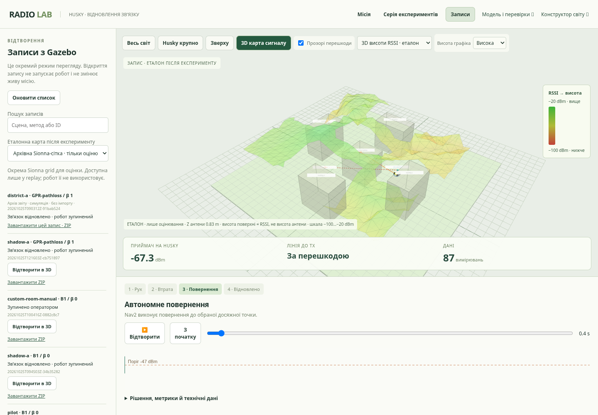

# Навчання GPR, дія моделі та повторні перевірки

Після оновлення репозиторію виконайте `bash scripts/run_demo.sh` і відкрийте
**http://127.0.0.1:8010/research.html**. На сторінці місій це посилання
**Модель і перевірки**. Для перегляду готових результатів не треба запускати
новий експеримент, імпортувати ZIP або чекати підготовки світу.

## Що показати під час демонстрації

1. У **Навчання** оберіть `district-a`, GPR noise 2, шар «Середній RSSI».
   Пересуньте повзунок від 4 показів до всієї історії або натисніть «Програти
   збір даних». Змінюються прогноз, число просторово різних точок у fit та MAE/RMSE.
   Праворуч залишається незалежна контрольна карта того самого RF-поля.
2. Перемкніть noise 8 / IDW та сцени. Наведіть на клітинку: показані позиція,
   прогноз, невизначеність, контрольний RSSI і належність до відкладеної вибірки.
   Шар σ доступний лише GPR: IDW не оцінює невизначеність.
3. У **Незалежна перевірка** покажіть остаточні test-помилки й розгорніть
   точні метрики. Test-поля не використовувалися для вибору параметрів.
4. У **Дія моделі** відкрийте спочатку повний збір історії, потім рішення GPR.
   Replay відкривається біля першої цілі. Оберіть «Прогноз карти»,
   «Невизначеність GPR» або «μ − βσ», натисніть Play / рухайте часовий повзунок.
   Видно Husky, Rx на ньому, доступні вимірювання, ціль, Nav2-шлях і RSSI у часі.
5. У **Повторна перевірка** порівняйте невдалий GPR-проїзд і повтор того самого
   RF-випадку після зміни Nav2. Кінцевий статус невдачі та timeout збережені.
   Діагностична картинка нижче стосується B1: вона ізолює проходження кута
   за однакових історії й цілі.
6. У таблиці проїздів виберіть **Лише невдалі**. Усі три невдалі GPR-спроби
   з трьох опублікованих серій залишаються доступними, з raw ZIP кожної.

Для одного безперервного прикладу є кнопка **Повна місія GPR · 3D висоти
RSSI**: додаткова перевірена місія `20261025T121603Z-cb751897`. У ній саме GPR
збирає дані під час виїзду, потім обирає повернення, без B1 seed-епізоду.
113 вимірювань, відновлення за 17.10 sim s, шлях повернення 6.65 m,
жодного втручання. Повний рух тривав 60.25 sim s; wall time 70.68 s у цій
хмарній перевірці. Цей окремий acceptance demo не змінює знаменники benchmark.

## 3D-карта висот сигналу під час демонстрації

На сторінці місії / replay натисніть **3D карта сигналу** або оберіть шар
**3D висоти RSSI · прогноз**. Над геометрією з’явиться напівпрозора поверхня:
сильніший RSSI — вище й зеленіше, слабший — нижче й червоніше.
Миша обертає сцену; **Весь світ** підбирає камеру з урахуванням поверхні.
**Висота графіка** змінює лише вертикальний масштаб візуалізації.
Наведення на поверхню показує найближчий вузол: RSSI, X/Y та фізичний Z антени.

Це графік RSSI над X/Y на одному зрізі висоти антени, не рельєф місцевості
і не фізична висота поширення хвилі. Шкала −100…−20 dBm фіксована між кадрами;
значення за її межами обрізані лише у кольорі/висоті, raw дані збережені.
Між сусідніми відомими вузлами поверхні — лінійна візуальна інтерполяція.
Невідомі/null-вузли, розділені ділянки й різні фізичні висоти не зшиваються;
трикутники через стіни на зрізі антени відкидаються.

У live поверхня є **прогнозом** поточної GPR/IDW за доступними показами й
оновлюється під час руху. Невідвідана область може мати помилковий прогноз;
перевіряйте також σ. При B0/B1 карта відображає IDW, хоча ціль обирається
за історією добрих вимірювань. Зображення не підмінює вимірювань Sionna.

У replay можна окремо обрати **Еталонна карта після експерименту** й шар
**3D висоти RSSI · еталон**. Для архівного прикладу сітка читається прямо з ZIP;
імпорт не потрібний. Перевіряються RF-hash і зріз Z антени. Напис
**ЕТАЛОН ПІСЛЯ ЕКСПЕРИМЕНТУ** позначає інформацію лише для оцінки: вона не
доступна live-контролеру й не змінює відтворені рішення. Повзунок часу
змінює прогноз за історією саме на той момент; еталон статичний.
**З початку** повертає replay до початку руху, **Відтворити** запускає перегляд.



Посилання на готовий replay читає вкладений ZIP прямо з репозиторію.
Воно не змінює локальне сховище та не запускає/зупиняє живу місію.
WASD/Space у вкладці replay не надсилають команди роботу.

## Що саме тут навчалось

Це **Gaussian Process Regression**, реалізація scikit-learn, і класична
навігація Nav2. Нейромережа та RL-policy у проєкті не навчалися.
Вхід GPR — координати антени Rx і виміряний RSSI; вихід — середній прогноз μ
та latent σ. GPR-pathloss спочатку підбирає тренд від логарифма відстані до Tx,
потім Matérn GP моделює залишок. Зберігаються до 150 останніх просторово різних
показів; близькі повтори на відстані <0.15 m не домінують у fit.

Кожне RF-поле має свій posterior за власними вимірюваннями. Між полями
порівнювали й обирали конфігурацію моделі, а не переносили одну глобально
навчену політику обходу. При втраті зв’язку модель пропонує клітинки з
μ − βσ ≥ −47 dBm; Nav2 перевіряє досяжність і обирається коротший шлях.
Прохід перешкод забезпечує Nav2 за occupancy-картою.

Криві на новій сторінці — **повторно обчислені posterior fits** на збережених
префіксах до першого `LINK_DEGRADED`, не історичний журнал епох. Точки
контролю зафіксовані до перебору префіксів: ≥1 m від кожного відомого положення
усієї історії до втрати. Тому близький до майбутнього показу контрольний RSSI
не дає ранньому кроку штучної переваги. Еталонні значення не входять у fit.
На кривих лише train/validation; courtyard test збережений як попередня
одноразова оцінка обраних профілів. Помилка не зобов’язана спадати.

Генератор: [build_learning_evidence.py](../scripts/build_learning_evidence.py).
Його JSON містить SHA256 джерельного архіву, коду моделі й скрипта, версії
бібліотек, префікси, точні fit-індекси, прогноз і контрольні метрики.
Прогнози округлені до 0.001 dB лише для показу; метрики обчислені до округлення.

## Зафіксовані результати

Відкладений тест містить 621 контрольну позицію у двох courtyard RF-полях.
6 train-полів — shadow/office/warehouse, 2 validation — district,
2 test — courtyard. Це п’ять геометрій з двома Tx, а не десять незалежних
типів місцевості. Остаточна macro MAE відносно незалежної Sionna-сітки:

| Модель | Test MAE, dB |
| --- | ---: |
| IDW | 9.55 |
| GPR-zero | 14.49 |
| GPR-pathloss, обраний noise 8 | 7.25 |

Результати керування слід читати окремо від похибки карти:

| Серія | GPR успіхи / усі GPR | Усі методи разом |
| --- | ---: | ---: |
| Початкова, noise 2 | 39/40 | 98/100 |
| Повтор із noise 8, старий Nav2 | 18/20 | 18/20 |
| Повтор після виправлення Nav2, noise 2 | 20/20 | 30/30 |

У noise-порівнянні використані саме 20 зіставлених baseline-проїздів,
які дали 20/20: 0 покращень, 2 погіршення, McNemar p=0.5.
У парному навігаційному порівнянні B1/GPR — 29/30 → 30/30, p=1.0.
Ці невеликі залежні набори не доводять статистично універсального виграшу.
Noise 8 не став стандартним для керування. Поліпшення проходження кута
після зміни Nav2 не є результатом перенавчання GPR.

Перша ціль GPR була справді безпечною за окремим точним Sionna-запитом
у 16/20 випадків при β=0 та 20/20 при β=1. Це оцінка вибору цілі, окрема від
успіху місії: зв’язок може відновитися дорогою чи після перепланування.

## Новий запуск і ваші результати

Натисніть **Нова місія GPR · β=1** у звіті. Посилання лише обирає метод:
сама місія починається після натискання **Запустити місію**. Звичайний B1
не використовує GPR для рішення, тому його успіх не є новим GPR-тестом.

Після проїзду поверніться у звіт і натисніть **Оновити** біля ваших записів.
Локальні GPR-епізоди показані окремо від відомих імпортованих архівних ID.
Доступні replay та raw ZIP. Підсумкові картки benchmark вище залишаються
зафіксованими; нові локальні місії автоматично не змінюють опубліковану оцінку.
Для нових серій/незалежних карт використовуйте [QUALITY](QUALITY.md) та
[DATASET_GUIDE](DATASET_GUIDE.md), фіксуйте конфігурацію й відкладені місцевості
до запуску. Зберігайте всі невдачі, таймаути та setup failures у знаменнику.

## Симуляція та польова перевірка

Усі наявні дані — **записані спостереження симуляції**: фізичний рух Gazebo,
офіційний Clearpath Husky і RSSI від Sionna. Фізичних польових вимірювань
антени/робота немає. Контрольна сітка незалежна від fit, але використовує
той самий RF-розв’язувач. Перевірки чутливості на обмежених точках дали
до 19.6 dB різниці при зміні бюджету променів/глибини/seed. Це не підтвердження
повнохвильової збіжності або точності на реальному обладнанні.

Для польового етапу потрібні синхронізовані час, Rx pose/RSSI, Tx pose,
частота/антени/потужність, калібрування RSSI й узгоджені одиниці/системи
координат. Виділіть окремі місцевості для train/validation/test; після
вибору параметрів зафіксуйте їх. На test порівнюйте MAE/RMSE, покриття
інтервалів, хибно безпечні цілі, частку/час/довжину повернень та втручання
оператора. Повторні проїзди виконуйте за тим самим протоколом і зі збереженням
усіх невдач. Цей польовий етап зараз позначений **не виконано**.

## Відтворення обчислень

З кореня репозиторію, у підготовленому Python-оточенні:

```bash
.venv/bin/python scripts/build_learning_evidence.py --output .runtime/recomputed-learning.json
.venv/bin/python -m unittest discover -s tests -p test_evidence.py -v
npm --prefix frontend run test:e2e -- tests/research.spec.js
```

Генератор читає лише опубліковані архіви; Gazebo і runtime-імпорт йому
не потрібні. CPU-залежності GPR встановлюються штатним setup проєкту.
Для іншого корпусу потрібні відповідні sources/reference/manifests;
підміна довільного поля еталоном з іншої сцени відхиляється.

Read-only API: `/api/research`, `/api/research/files/<дозволений файл>`,
`/api/research/runs/<серія>/<ID>` та такий самий шлях із `.zip`.
Еталон: `/api/research/references/<серія>/<ID>`, лише для оцінювання у replay.
Відтворення читає лише три зафіксовані серії або окремі demo; довільні
шляхи файлової системи не підтримуються.
