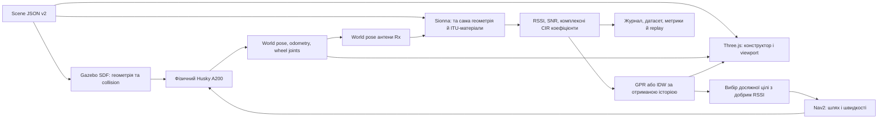

# Як працює Radio Lab і що показати на презентації

Стан на 25 жовтня 2026 року, реалізація після `c25e849`. Гайд призначений
для доповідача, користувача демонстрації та розробника, який прийматиме проєкт.
Окремий повний перелік можливостей — [FEATURE_CATALOG](FEATURE_CATALOG.md).
Відповідність конкретній рубриці **5 + 5 + 5**, прогрес відносно пропозалу,
підтверджений розподіл роботи та подальший план — [DEFENSE_CRITERIA](DEFENSE_CRITERIA.md).

## Зміст

1. [Що саме демонструємо](#1-що-саме-демонструємо)
2. [Запуск та екрани](#2-запуск-та-екрани)
3. [Зв’язок між радіосимуляцією та світом](#3-звязок-між-радіосимуляцією-та-світом)
4. [Радіофізика, сигнал і модуляція](#4-радіофізика-сигнал-і-модуляція)
5. [Моделювання приміщень і положення Tx/Rx](#5-моделювання-приміщень-і-положення-txrx)
6. [Рух Husky та команди](#6-рух-husky-та-команди)
7. [Втрата зв’язку, очікування й повернення](#7-втрата-звязку-очікування-й-повернення)
8. [Як навчалась модель](#8-як-навчалась-модель)
9. [Як перевіряли результат](#9-як-перевіряли-результат)
10. [Інтерфейс моделі та майбутньої нейромережі](#10-інтерфейс-моделі-та-майбутньої-нейромережі)
11. [Дані, повторення та нові експерименти](#11-дані-повторення-та-нові-експерименти)
12. [Сценарій презентації](#12-сценарій-презентації)
13. [Відповіді на питання й межі висновків](#13-відповіді-на-питання-й-межі-висновків)

## 1. Що саме демонструємо

Робот Clearpath Husky A200 їде зі встановленим приймачем Rx у середовищі
з нерухомим передавачем Tx. Геометрія та матеріали впливають на канал.
Система записує положення й RSSI, оцінює радіокарту та після погіршення
зв’язку обирає точку повернення. Nav2 планує і виконує шлях до неї.

Фраза для першого слайда:

> «Ми інтегрували Gazebo, офіційну модель Husky, Sionna RT та Nav2 в середовище
> для дослідження повернення робота до зв’язку. GPR за отриманими радіопоказами
> прогнозує, де сигнал може бути достатнім; Nav2 відповідає за рух і об’їзд».

| Частина | Поточна реалізація |
| --- | --- |
| Радіопоширення | NVIDIA Sionna RT 2.2.0, Mitsuba/Dr.Jit, CPU LLVM |
| Фізика руху та зіткнень | Gazebo Harmonic, офіційний Clearpath A200 |
| Обмін і навігація | ROS 2 Jazzy, Nav2 |
| Прогноз RSSI | GPR у scikit-learn 1.7.2; також IDW і контрольні B0/B1 |
| Відображення | Браузерний Three.js, який відображає фактичні pose/joint states |
| Навчена нейромережа / RL | Відсутні; інтерфейс для подальшого додавання описаний нижче |
| Джерело наявних даних | Симуляційні вимірювання; польових даних фізичного Husky немає |

Власноруч написаний код інтеграції, конструктора, монітора зв’язку, експериментів
і логування. Радіорозв’язувач, фізика робота та Nav2 взяті з готових бібліотек.

## 2. Запуск та екрани

### Повна жива демонстрація

Linux, встановлені Docker/Compose, Python та Node.js; повні вимоги —
[USER_GUIDE](USER_GUIDE.md). З кореня репозиторію:

```bash
git pull --ff-only
bash scripts/run_demo.sh --start
```

Скрипт збирає frontend та образи, запускає два сервіси, чекає готовності
Radio/Husky API й один раз просить запустити швидку GPR-місію з β=1.
Перший build може бути довгим. `Mission preparation requested: starting`
означає, що підготовку прийнято; світ і Nav2 ще можуть завантажуватись.

Відкрийте **http://127.0.0.1:8010/experiments.html**.
3D-поверхня RSSI вже вибрана. Повторно натискати старт не потрібно.

Якщо сервіси вже працюють, достатньо:

```bash
python3 scripts/start_demo.py
# Окремий наступний проїзд в іншому середовищі:
python3 scripts/start_demo.py --mission office
```

Другий проїзд починайте після завершення/зупинки першого. Для ручного старту
в UI використовуйте `bash scripts/run_demo.sh` без `--start`.
Після нового оновлення коду штатний run script перебудовує frontend і перезапускає
сервіси; `docker compose up -d --no-build` використовує вже наявні образи.

### Три браузерні екрани

| URL | Що показуємо |
| --- | --- |
| `http://127.0.0.1:8010/` | Конструктор: приміщення, матеріали, Tx/Rx, JSON, recording/grid |
| `http://127.0.0.1:8010/experiments.html` | Місія, ручний рух, серії, replay, карта й рішення |
| `http://127.0.0.1:8010/research.html` | Навчання за префіксами даних, незалежний test, невдачі та повтори |

Окремий штатний Gazebo desktop-клієнт на Linux після запуску світу:

```bash
bash scripts/gazebo_gui.sh
# Спостереження за воркером серії:
bash scripts/gazebo_gui.sh --worker 0
```

Потрібні DISPLAY/X11 або XWayland та xauth. Cloud-перевірки виконувалися
headless; інтерактивний desktop GUI там не перевірений. Браузерний viewport
і Gazebo GUI — різні клієнти одного симульованого світу.

### Як завершити показ

**Стоп** у місії / Space гальмує робот і завершує експеримент; симулятор може
залишатися прогрітим. **Завершити Husky** у конструкторі зупиняє симуляцію.
`docker compose down` завершує весь стек. У replay команди керування вимкнені.

## 3. Зв’язок між радіосимуляцією та світом



Scene v2 є спільним описом. Після **Застосувати сцену** backend валідує JSON,
створює Sionna-сцену, `world.sdf` та occupancy-карту для Nav2.
Матеріал стіни має радіопараметри в Sionna; у Gazebo ця сама стіна є collision
геометрією. Зміна прозорості у viewport впливає лише на показ.

Gazebo обчислює рух, а Sionna — радіоканал для захопленої пози Rx. Це
дискретна інтеграція: розрахунок каналу має власну затримку й не є одним
спільним покроковим електромагнітним/механічним розв’язувачем.
Файли результатів зберігають час пози та час доступності показу.

Кожна радіосцена виконується в окремому worker-процесі. Помилка native/JIT
ізольована від HTTP backend; модель обробляє запити послідовно. Довгий grid
запускається фоново. Сцена, її revision і покоління reset захищають від
прийняття старих показів після заміни світу.

## 4. Радіофізика, сигнал і модуляція

### Що розраховує Sionna

Для поточного положення Rx `PathSolver` шукає шляхи з увімкненими
specular reflection, refraction, diffraction та edge diffraction.
Стіни й перешкоди описані поверхнями box-геометрії з ITU-матеріалом
і товщиною радіошару. Частота впливає на поширення та властивості матеріалів.

Використовується один Tx та один Rx, масиви 1×1, ізотропний pattern,
вертикальна поляризація. Поворот стрілки антени не означає реалізацію
керованої вузькоспрямованої діаграми.

Результат каналу — комплексні коефіцієнти `a_k` і абсолютні затримки `τ_k`.
Фаза несучої вже врахована в `a_k`; код не додає її вдруге:

```text
g = |Σ a_k|²
RSSI_dBm = P_tx_dBm + 10 log10(g)
N_dBm = −174 + 10 log10(B_Hz) + NF_dB
SNR_dB = RSSI_dBm − N_dBm
```

Комплексне додавання створює конструктивну/деструктивну інтерференцію
шляхів одного передавача. Тому рух на невелику відстань може дати значну
зміну RSSI; віддаленіша точка не завжди має слабший сигнал.
Без знайденого ненульового каналу RSSI/SNR дорівнюють `null`.

Налаштування: частота, Tx power, bandwidth, noise figure, період sampling,
seed, глибина трасування та бюджети променів/шляхів. Типовий сценарій:
2.4 GHz, 20 dBm, 20 MHz, NF=5 dB, depth=3, 10 000 променів/джерело.

### Що означає «модуляція у світі»

Якщо йдеться про **моделювання світу**, це редагування геометрії/матеріалів
у конструкторі, описане в наступному розділі.

Якщо йдеться про **модуляцію радіосигналу**, поточна система обчислює канал
і вузькосмугову потужність. Генератор бітів, QPSK/QAM/OFDM, кодування,
демодулятор, BER/BLER, MAC, PDR і throughput не реалізовані.
Bandwidth зараз входить у thermal-noise SNR; це не симуляція OFDM-піднесучих.
Noise figure також не додає випадковий шум до кожного RSSI-показу.

CIR можна використати як вхід майбутньої PHY-моделі, але для неї потрібна
окрема реалізація передавача/приймача та перевірка нормування/фаз/затримок.
У презентації кажемо «моделювання радіоканалу», а результат втрати називаємо
**RSSI-критерієм**, не доведеною втратою пакетної доставки.

### Межі радіомоделі

Це геометричне трасування скінченної глибини, а не повнохвильове розв’язання
рівнянь Максвелла. Власної моделі «всіх ефектів із точною фізичною похибкою»
немає. Не моделюються інші передавачі/завади, RF-екранування корпусом Husky,
часове fading як окремий процес або рухомі радіоперешкоди.
Seed керує чисельним пошуком шляхів, а не відтворює часовий радіошум.
Матеріальна slab-модель і замкнені box-поверхні потребують калібрування.

## 5. Моделювання приміщень і положення Tx/Rx

### Що робити в конструкторі

1. Відкрити `/` та вибрати «Кімната», «Коридор», «Склад», «Двір» або порожню сцену.
2. Додати стіну, перешкоду, дверну стіну чи стелю. Вибрати об’єкт у списку/viewport.
3. Змінити центр X/Y/Z, розміри, yaw, матеріал і товщину радіошару.
4. Розмістити Tx; для Rx обрати static або кріплення на Husky.
5. Натиснути **Застосувати сцену**. До цього зміни є чернеткою UI.
6. Зберегти JSON. Його можна передати іншому розробнику та відкрити повторно.

Двері — справжня відсутність геометрії між сегментами, а не текстура.
Матеріали: `concrete`, `brick`, `plasterboard`, `wood`, `glass`, `metal`.
Об’єкти можна рухати gizmo/числами, повертати, дублювати й видаляти.
Прозорі стіни/стеля та вигляд згори допомагають показати внутрішню структуру.

### Координати

World/map — правобічна система, Z угору, метри. У JSON орієнтації антен
мають порядок `[yaw, pitch, roll]` у rad, quaternion — `[x,y,z,w]`.
UI для поворотів показує градуси. Waypoint `[x,y,yaw]` містить **кут**, не Z.

Для mounted Rx використовується повний rigid transform:

```text
T_world_antenna = T_world_base × T_base_antenna
```

Поворот робота повертає й зміщення антени; координати не отримуються
простим додаванням spawn до odometry. У типових місіях mount `[0,0,0.7]`,
а settled base Z близько 0.13228 m, тому фізична висота антени близько 0.83228 m.

Для своєї геометрії після Apply перейдіть у **Місія → Поточна сцена конструктора · WASD**.
Система зберігає Tx, геометрію та mount, готує Husky й запускає ручне дослідження.
Власний JSON не отримує автоматично маршруту до гарантованої радіотіні:
у новому середовищі маршрут/дослід треба задати або пройти вручну.

### Два значення «висоти карти»

| Висота | Значення |
| --- | --- |
| Z антени / Z зрізу grid | Фізична координата, де Sionna обчислює RSSI |
| Висота кольорової 3D-поверхні | Графік RSSI над X/Y; сильніший сигнал вище |

Поверхня не є фізичною формою радіохвилі. Вибраний діапазон фіксований між
кадрами: за q=−47 dBm стандартна чутлива шкала −67…−27 dBm, амплітуда 10.
Поблизу порога зміна 1 dB дає вчетверо більший перепад, ніж у попередньому
масштабі. Регулятори змінюють лише зображення, а не RSSI чи рішення робота.
Порожні/null ділянки та стіни не зшиваються поверхнею. Є fullscreen і наведення
на вузол із RSSI/X/Y/фізичним Z. Для просторої RF-сітки можна зібрати кілька Z-шарів.

## 6. Рух Husky та команди

### Хто керує колесами

Gazebo запускає офіційний Clearpath URDF із його приводом і зіткненнями.
Браузер відображає шість офіційних visual meshes, actual world pose та кути
wheel joints. Він не пересуває робот «анімацією по готовій лінії».

Nav2 має статичну occupancy-карту зі сцени, ground-truth localization,
NavFn/A* planner і Regulated Pure Pursuit controller. Карта перешкод відома
наперед; SLAM/AMCL та динамічне lidar-виявлення не налаштовані.
Планування зараз відбувається у площині X/Y. Рух не навчається нейромережею.

| Режим | Джерело команди | Що робить |
| --- | --- | --- |
| TELEOP | WASD/стрілки або HTTP control | Лінійна та кутова швидкості |
| SURVEY | Список waypoint | Nav2 їде в напрямку радіотіні й збирає дані |
| LINK_SUSPECT / LINK_DEGRADED | Монітор RSSI | Hold, перевірка сигналу й гальмування |
| RECOVERY | Вибір цілі за RSSI + Nav2 | Автономний рух до досяжної безпечної точки |
| Завершення / помилка | Монітор/оператор/runtime | Нульові команди, збереження результату |

### Ланцюжок команд

```text
WASD → POST /api/robot/control {linear, angular}
     → runtime POST /control
     → geometry_msgs/TwistStamped: linear.x, angular.z
     → /a200_0000/platform/cmd_vel → офіційний привід Husky

Ціль [x,y,yaw] → ComputePathToPose → NavigateToPose
     → Nav2 /a200_0000/nav_cmd_vel (Twist)
     → runtime арбітраж → /a200_0000/platform/cmd_vel (TwistStamped)
```

W/S задають ±0.5 m/s, A/D — ±0.8 rad/s у frame кузова; одночасне натискання
дозволяє їхати з поворотом. UI надсилає утримувану команду кожні 100 ms.
HTTP межі — ±1 m/s та ±1.5 rad/s. Один ручний POST не означає безкінечного руху:
lease команди становить 0.5 wall s. Публікація runtime та Nav2 controller — 20 Hz;
цільова швидкість Nav2 — 0.6 m/s, з регулюванням біля перешкод.

Ручна ненульова команда під час автономного керування відхиляється;
нуль від відпускання клавіші не скасовує автономію. `/nav/hold` скасовує goal
і тримає нуль. `/nav/cancel` повертає teleop authority. Stop експерименту та
повне вимкнення симулятора — окремі дії.

### Основні ROS-інтерфейси

| Інтерфейс | Тип / призначення |
| --- | --- |
| `/clock` | `rosgraph_msgs/Clock`, час симуляції |
| `/simulation/poses` | `tf2_msgs/TFMessage` після bridge з Gazebo `/husky/world_pose` |
| `/a200_0000/platform/odom/filtered` | `nav_msgs/Odometry`, швидкості кузова та odometry |
| `/a200_0000/platform/joint_states` | `sensor_msgs/JointState`, кути коліс |
| `/a200_0000/nav_cmd_vel` | `geometry_msgs/Twist`, вихід Nav2 |
| `/a200_0000/platform/cmd_vel` | `geometry_msgs/TwistStamped`, фактичний командний вихід runtime |
| `/a200_0000/compute_path_to_pose` | action `nav2_msgs/ComputePathToPose` |
| `/a200_0000/navigate_to_pose` | action `nav2_msgs/NavigateToPose` |
| `/radio/measurement` | `std_msgs/String` із JSON поточного радіовимірювання |

Runtime вибирає world pose за ім’ям `a200_0000/robot`, формує ground-truth
map→odom та надсилає telemetry HTTP backend приблизно кожні 0.1 wall s.
Окремий старий `app/ros_radio.py` використовує odom+spawn offset;
у штатній сучасній місії працює world-pose pipeline з `husky_runtime.py`.

## 7. Втрата зв’язку, очікування й повернення

Повний актуальний опис — [LINK_PROTOCOL](LINK_PROTOCOL.md).
Швидкий режим є стандартним для живої місії; benchmark-серії мають
окремий попередній протокол, щоб зберігати порівнюваність результатів.

| Подія | Стандартна реакція швидкого режиму |
| --- | --- |
| Перший raw RSSI <−48 dBm | Негайний запит hold; перехід LINK_SUSPECT |
| Слабкі покази ≥0.5 sim s, щонайменше 2 різні свіжі | LINK_DEGRADED, очікування зупинки |
| Короткий провал минув | Після ≥1 s RSSI ≥−47 dBm і зупинки можна продовжити виїзд |
| Після провалу немає стабільного відновлення за 2 sim s | Консервативне повернення, причина `verification_timeout` |
| Кузов <0.03 m/s, yaw rate <0.05 rad/s щонайменше 0.1 sim s | Можна відправити recovery goal; подія `brake` |
| Під час повернення raw і згладжений RSSI ≥−47 dBm протягом 1 sim s | Hold та завершення RECOVERED_WAIT |
| Помилка solver, старий показ >1.5 sim s, рух >0.5 m від його позиції | FAILED/hold, без підміни показу низьким RSSI |

Sampling має бажаний крок 0.25 sim s, фактична частота залежить від solver/CPU.
Гальмування починається на першому слабкому raw показі, до GPR fit цього кроку.
Згладжування у вікні 0.5 s для відновлення виконується в лінійній потужності.
Дублі/застарілі покази не підтверджують втрату. `null` від валідного розрахунку
без шляхів означає відсутність сигналу; виняток обчислення є окремою помилкою.

Підтверджена слабкість і консервативне повернення мають різні
`loss_decision`. Перед поверненням вимірюється фактичне гальмування.
Повернення не зобов’язує доїхати до кінцевого anchor і не є командою «S назад»:
Nav2 може їхати вперед іншим доступним шляхом.

Timeout усієї типової місії — 150 sim s, окремий wall ліміт 8×;
очікування гальмування обмежене 4 wall s. Runtime має deadman для старих
velocity-команд і втрати backend; безпечна досяжна ціль також може не знайтися.
Критерій успіху — зазначений RSSI-протокол, не гарантія майбутньої якості каналу.

## 8. Як навчалась модель

### Три задачі, які треба розрізняти

| Задача | Поточний спосіб |
| --- | --- |
| Прогнозувати RSSI в позиції | IDW або навчання GPR за отриманими `(x,y,z,RSSI)` |
| Обрати ціль повернення | Правило безпечності та найкоротший досяжний Nav2-шлях |
| Об’їхати перешкоди й керувати колесами | Класичні Nav2 planner/controller |

Навчали **регресійну радіокарту**, а не нейромережу дій робота. У репозиторії
немає NN epochs, `.pt`-ваг чи RL reward/training loop. При нових показах
`Experiments.update_model()` заново викликає `RadioMap.fit()` та `predict()`.
Модель кожного RF-поля підлаштовується під його власну історію; спільно між
світами порівнювались конфігурації, а не переносилась одна глобальна policy.

### Дані та GPR-pathloss

До fit потрапляють до 150 останніх просторово різних валідних показів.
Близькі повтори <0.15 m відсіюються; `null` не перетворюється на 0 dBm.
GPR отримує координати й RSSI, а не зображення сцени чи список стін.
Матеріали та перешкоди впливають на його дані через Sionna; саму геометрію
для прохідності бачить Nav2. Частота/світ зафіксовані в конкретному епізоді:
модель не навчена глобально переносити прогноз між усіма частотами й будівлями.
GPR-pathloss спочатку підбирає least-squares тренд:

```text
d = max(0.1 m, ||position_rx − position_tx||)
m(position) = b0 + b1 log10(d)
residual_i = RSSI_i − m(position_i)
```

Далі Gaussian Process із Matérn ν=1.5 моделює residual. Початкова length scale
2 m, амплітуда ядра 1600 dB². `noise_db=2` дає α=4 dB² у GP; це параметр
регресії, відмінний від `radio.noise_figure_db`. Оптимізація ядра опційна,
у стандартній живій конфігурації вимкнена. Вихід — середній μ та latent σ.

| Метод | Поведінка |
| --- | --- |
| B0 | Остання відома добра точка історії; Nav2 перевіряє досяжність |
| B1 | Добра виміряна точка з найкоротшим доступним Nav2-шляхом |
| IDW | Вагове усереднення RSSI за оберненим квадратом 3D-відстані; σ немає |
| GPR-zero | GP із нульовим prior; доступний для діагностики, є ризик оптимістичного прогнозу далеко від даних |
| GPR-pathloss | Тренд за відстанню + GP residual і оцінка σ |

Для GPR кандидат повинен задовольняти `μ − βσ ≥ q_safe`.
β=0 ігнорує невизначеність; β>0 зменшує допустимий прогноз у невідомій зоні.
Після цього відкидаються перешкоди/недосяжні цілі й порівнюються довжини шляхів.
У B0/B1 карта на екрані інтерполюється IDW; рішення цих методів береться з історії.

### Offline підбір і незалежна оцінка

Шість RF-полів train: shadow/office/warehouse з двома Tx; два validation —
district; два test — courtyard. Це п’ять сімейств геометрії, не десять
незалежних типів місцевості. Перевірялись noise 2/4/8 dB й оптимізація ядра.
Кандидатів обирали на train, фінальну конфігурацію — на validation;
після цього обрані профілі один раз оцінено на test.

Контрольні Sionna-сітки не входять у fit або вибір цілі. Просторовий holdout
не ближче 1 m від усієї відомої історії. На екрані навчання криві побудовані
повторними fits за 4/8/16/32/48/64/повним числом записаних показів;
це реконструкція з архіву, не журнал епох. Для кривих використані лише
train/validation; незмінний holdout виключає сусідів також майбутніх показів.

## 9. Як перевіряли результат

### Готові результати для слайдів

| Перевірка | Результат | Як трактувати |
| --- | --- | --- |
| Початкова paired-серія, усі методи | 98/100 | Усі невдачі збережені; це повернення зі спільних checkpoint |
| GPR у цій серії | 39/40 | Решта запусків — B0/B1/IDW |
| Профіль noise 8, старий Nav2 | 18/20 GPR | Менша MAE не дала кращого керування |
| Після виправлення кута Nav2 | 30/30 загалом, 20/20 GPR | Змінена навігація, не перенавчена NN |
| Відкладений test радіокарти | IDW 9.55; GPR-zero 14.49; GPR-pathloss 7.25 dB macro MAE | Останній показник належить обраному noise 8, не стандартному noise 2 |
| Добра перша GPR-ціль | β=0: 16/20; β=1: 20/20 | Окремий точний Sionna-запит після експерименту |
| Нова швидка місія, будівля | 139 показів, brake 0.288 m, повернення 11.20 s / 1.53 m | Окрема acceptance-перевірка, не новий знаменник старого benchmark |
| Нова швидка місія, офіс | 131 показ, brake 0.288 m, повернення 11.35 s / 1.72 m | Також перевірений запуск через CLI |

У швидкій місії реакція відбулась за 7.45 m до контрольного anchor.
Усі часи руху в таблиці — sim s. Нова логіка отримала додаткові перевірки
гальмування, дублів, короткого провалу, граничних значень та помилок.

Метрики мають різні знаменники:

```text
MAE = mean(|predicted − reference|)
RMSE = sqrt(mean((predicted − reference)²))
success_fraction = успішні / усі спроби, включно з невдалими setup
recovery_time_s = час завершення − момент переходу до підтвердженої втрати/повернення
```

Macro MAE усереднює помилку спочатку в кожному полі, потім між полями.
Час/шлях серед успішних аналізуються разом із часткою невдач, щоб timeout
не виглядав «швидким коротким поверненням». Гальмівні час/зміщення — окремі метрики.

Парне порівняння noise-профілів: 0 покращень / 2 погіршення, McNemar p=0.5.
Навігаційна пара: 1 покращення / 0 погіршень, p=1.0. Повтори в тих самих
світах залежні; це опис невеликого набору, не доказ універсальної переваги.
Виміряна чутливість Sionna до бюджету/seed сягала 19.6 dB на перевірених точках.
Фізична точність на апаратурі та глобальна збіжність цим не доведені.

### Де показати докази

У `/research.html`: криві, карти прогнозу/контролю, test-таблиці, усі GPR-проїзди,
фільтр невдач, ZIP/CSV/JSON, старі й повторні проїзди та швидка демонстрація.
Відкриття архівів не запускає робот і не потребує попереднього імпорту.
Reference-карта доступна лише для оцінки в replay, зі звіркою RF-hash/Z.
Для нового responsive-протоколу контрольну grid не опубліковано: чужий еталон
не підставляється. Окремий приклад старого протоколу має еталон для порівняння.

Корпус містить 150 paired recovery, 10 повних source-місій та 7 356 reference
позицій на трьох висотах. 14 964 записи benchmark пораховані без дублювання
seed-історій; 9 reference RSSI=null. Окремі demo-проїзди не включені в ці числа.
Джерела й пояснення — [README корпусу](../examples/experiments/shadow-benchmark/README.md).

## 10. Інтерфейс моделі та майбутньої нейромережі

### Що доступне зараз через UI/API

Можна обирати метод, β, шум GPR, поріг, часи підтвердження; запускати місії,
отримувати observations/maps/targets та ZIP; відтворювати їх у часі.
REST API керує експериментом, а не чатом з нейромережею.
Окремого `/api/model/predict`, завантаження NN-ваг чи універсального plugin-loader немає.

Запуск із Python без залежностей ML на клієнті:

```python
import json
import urllib.request

payload = {
    "mission": "shadow",
    "response_profile": "responsive",
    "config": {"method": "GPR-pathloss", "beta": 1, "noise_db": 2}
}
request = urllib.request.Request(
    "http://127.0.0.1:8010/api/mission/start",
    data=json.dumps(payload).encode(),
    headers={"Content-Type": "application/json"},
)
with urllib.request.urlopen(request, timeout=10) as response:
    print(json.load(response))
```

Приклад надсилає **живий старт**: сервіси мають бути готові, іншого активного
експерименту немає. Для звичайного запуску краще `start_demo.py`: він уже
обробляє startup resets і чекає обидва API. Не повторюйте POST автоматично
після обриву з невідомим результатом.

Читання поточного стану й збереженої історії:

```bash
curl -fsS http://127.0.0.1:8010/api/state
curl -fsS http://127.0.0.1:8010/api/experiments
# Підставити фактичний ID замість RUN_ID:
curl -fsS http://127.0.0.1:8010/api/experiments/RUN_ID
```

`map`-події містять позиції клітинок, `mean_dbm`, `std_db`, `lower_dbm`,
`training_indices`, число доступних observations і версію fit.
`target` містить обрану base-позу, шлях, його довжину й прогноз.

Сторонній алгоритм також може працювати як окремий HTTP-клієнт:
читати `/api/state`, обирати позицію та надсилати
`POST /api/navigation/goal {"position":[x,y,yaw_rad]}` на готовому Husky/Nav2.
Це вже наявний інтерфейс керування, а сама NN та її preprocessing — робота
зовнішнього клієнта. Для цього експеримент, який володіє автономним керуванням,
треба завершити. Без активного `Experiments` його RSSI-monitor не працює:
зовнішній агент має окремо забезпечити перевірку сигналу/даних і hold/cancel.
Якщо потрібен чинний loss/brake/recovery loop, модель інтегрують усередину
`update_model()` за контрактом нижче.

### Прямий Python-інтерфейс GPR

Реальний контракт у [app/radio_maps.py](../app/radio_maps.py):

```python
model = RadioMap(method, transmitter_xyz, noise_db=2.0, optimize=False)
model.fit(observations)        # кожен рядок: position_m [x,y,z], rssi_dbm
mean_dbm, std_db = model.predict(points_xyz)
```

Спробувати на збережених даних без запуску нового світу:

```bash
docker compose exec -T radio python - <<'PY'
from app.evidence import EvidenceLibrary
from app.radio_maps import RadioMap

library = EvidenceLibrary()
identity = (library.root / 'responsive-demo-id.txt').read_text().strip()
run = library.run('responsive-demo', identity)
history = []
for event in run['timeline']:
    if event['kind'] == 'observation':
        history.append(event['measurement'])
    if event['kind'] == 'mode' and event['mode'] == 'LINK_DEGRADED':
        break

config = run['manifest']['config']
model = RadioMap('GPR-pathloss', run['scenario']['tx']['position'],
                 noise_db=config['noise_db']).fit(history)
points = [history[0]['position_m'], history[-1]['position_m']]
mean, std = model.predict(points)
print('Available:', len(history), 'used in fit:', len(model.training_indices))
for point, mu, sigma in zip(points, mean, std):
    print(point, 'mean dBm:', mu, 'latent sigma dB:', sigma)
PY
```

Це окремий offline fit за реально записаним симуляційним префіксом.
Він не змінює live-модель і не надсилає команди руху. Сам `predict()` не
перевіряє прохідність позиції: перевірки geometry/Nav2 виконує експеримент.

### Як додати нейромережу наступному розробнику

Нижче — точка розширення, а не вже реалізований NN-функціонал.

1. Визначити задачу NN: прогноз RSSI або керування діями. Поточний контракт
   безпосередньо підходить для прогнозу карти; NN-policy руху потребує іншого loop.
2. Для прогнозу реалізувати еквівалент `fit(observations)` / `predict(points)`
   або adapter до зафіксованих pretrained weights. Вихід має відповідати
   одиницям dBm та порядку query-позицій; зберегти spatial mask і причинність.
3. Додати метод до `METHODS`/валідації та інтегрувати в `Experiments.update_model()`.
   Зараз там прямо створюється `RadioMap`; автоматичного discovery немає.
4. Додати вибір у UI/runner та metadata: архітектуру, preprocessing,
   train/validation/test, seed, версію й hash ваг. Зараз файлів таких ваг немає.
5. Якщо використовується β>0, забезпечити калібровану невизначеність.
   Поточна формула для `std=None` підставляє 0; відсутність σ у нової NN
   не можна трактувати як впевненість. Потрібен guard або обмеження β=0.
6. Залишити той самий Nav2, loss monitor, logger і paired-контроль; порівняти
   якість карти, помилки безпечних цілей, частку повернень, час, шлях і втручання.

Для NN-планувальника окремо потрібні action/state interface, collision/stop
обмеження та навчальний протокол; лише заміна `RadioMap` не навчає об’їзду.

## 11. Дані, повторення та нові експерименти

### Два формати

| Збір | Вміст ZIP |
| --- | --- |
| Recording / grid | `manifest.json`, `scenario.json`, `measurements.csv`, `measurements.jsonl`, `events.jsonl` |
| Автономна місія | `manifest.json`, `scenario.json`, `timeline.jsonl` із pose/observation/map/target/route/mode/brake |

CSV зручний для таблиць; комплексний CIR зберігається у JSONL, якщо його
збереження увімкнене. Вимкнення CIR не спрощує розрахунок RSSI: комплексні
шляхи все одно обчислюються, зменшується серіалізація/обсяг журналу.

`sim_time_s` показу — час захопленої пози; `available_at_sim_time_s` — коли
вимір став доступним контролеру. Replay використовує доступні на курсорі
події; майбутні observations/карти не підтягуються назад.
Manifest містить параметри, статус, метрики, software versions,
implementation/nav-config hashes, snapshot сцени та RF-hash.

### Що можна зробити далі без зміни коду

- Створити нову кімнату, змінити матеріал/товщину, Tx/Rx або частоту й зберегти JSON.
- Зібрати статичну 3D-сітку RSSI на кількох висотах або траєкторний recording.
- Пройти новий ручний маршрут із Rx на Husky та оцінити повернення.
- Порівняти B0/B1/IDW/GPR, β=0/1 та noise 2/8 за однаковим протоколом.
- Запустити 100+ епізодів, завантажити raw дані та повторити аналіз.
- Використати зафіксовану історію для paired-порівняння методів.

Приклад серії зі старим benchmark-протоколом; він справді запускає роботів:

```bash
python3 scripts/run_experiments.py --runs 100 --workers 2 --protocol paired \
  --methods B0 B1 IDW GPR-pathloss --betas 0 1 \
  --output .runtime/reports/presentation-series
```

`paired` спочатку збирає повну source-історію до втрати, потім порівнює
реальні повернення зі спокою в однаковому checkpoint. `full` виконує весь
виїзд для кожного епізоду. Воркери 1–4 мають власні ROS domain/Gazebo partition.
Warm reset прискорює підготовку; тривалість залежить від CPU й RF-бюджету.
Параметр `--resume ID` продовжує незавершені індекси, не стираючи минулі спроби.

Деталі збору — [DATASET_GUIDE](DATASET_GUIDE.md), формату місії —
[EXPERIMENT_FORMAT](EXPERIMENT_FORMAT.md), оцінки — [QUALITY](QUALITY.md).
Для дослідження нової NN треба окремо зафіксувати новий split і не підбирати
її за вже відомим test. Свої `.runtime` дані слід передати окремо: вони поза Git.

## 12. Сценарій презентації

### Підготовка перед виступом

Запустіть сервіси, перевірте доступність трьох сторінок і відтворення архіву.
Приготуйте новий JSON сцени та вибрані ZIP/CSV. Живу місію запускайте окремо
від серії. Тримайте поруч збережений responsive replay: він дозволяє показати
результат навіть без очікування нової фізичної симуляції.

Готовий запис швидкого повернення:

**http://127.0.0.1:8010/experiments.html?evidence=responsive-demo&run=20261025T124848Z-bf0a13e6&layer=height&phase=first-map**

Це **ЗАПИС**, не live; натисніть «Відтворити» / «З початку».

### Основна розповідь на 12–15 хвилин

| Час | Дія/слайд | Що проговорити та який доказ видно |
| --- | --- | --- |
| 0–1 хв | Мета, GitHub і pipeline | Tx/Rx; розділення Sionna/Gazebo/GPR/Nav2; revision і запуск |
| 1–2 хв | Baseline та вибір моделі | B0/B1/IDW, чому Matérn GPR/path-loss; що означає β |
| 2–5 хв | Конструктор + live або позначений replay | Стіна/матеріал/Tx/Rx; рух → падіння RSSI → brake → return; поверхня/fullscreen |
| 5–7 хв | Навчання й метрики | Prefix slider, MAE/RMSE, test, 16/20 проти 20/20 цілей; джерела й знаменники |
| 7–9 хв | Прогрес і внески | Пропозал → виконано → змінено → hardware-етап; підтверджені зони трьох учасників |
| 9–10 хв | Невдачі й причини | Noise 8 і Nav2 corner case, повторна перевірка; що висновки дозволяють сказати |
| 10–12 хв | Подальший план і дизайн | Виходи/дати етапів, нові split/умови, однакові протоколи та hardware gate |
| 12–14 хв | Plan B і наступна амбіція | Дії без обладнання/без виграшу GPR; active sampling як stretch goal |
| 14–15 хв | Підсумкові докази | Матеріали/репозиторій, виконане проти наступних етапів, межі висновків |

Ця структура відводить час усім трьом блокам рубрики. Внески:
Гордій — радіосимуляція/дані; Владислав — GPR/IDW/невизначеність;
Володимир — ROS/Nav2/експерименти/оцінювання. Конкретні артефакти та
план у [DEFENSE_CRITERIA](DEFENSE_CRITERIA.md). Наявність фізичного
перенесення оцінюється як наступний етап, а RSSI recovery уже показується зараз.

### Повний список демонстрацій, із якого можна обирати

| Що показати | Де / як | Що це доводить |
| --- | --- | --- |
| Порожня сцена, кімната, коридор, склад, двір | Пресети конструктора | Різні редаговані середовища |
| Додавання/дублювання/поворот стіни | Ліва панель, inspector/gizmo | Власна геометрія без коду |
| Реальний дверний прохід | Дверна стіна та вигляд згори | Відсутність collision-геометрії у прорізі |
| Матеріал та радіотовщина | Inspector → concrete/glass/metal | Параметри RF-сцени; потрібен новий вимір/Apply |
| Tx/Rx у 3D і mount | Вибір передавача/приймача/Husky | Одна система координат і прив’язка антени |
| Збереження та відкриття сцени | JSON у шапці | Передавання конфігурації іншому користувачу |
| Один RSSI/SNR/CIR вимір | «Виміряти у приймачі», details/JSON | Робота PathSolver і комплексні дані каналу |
| Частота/потужність/бюджет трасування | Панель радіоканалу | Керовані умови чисельного досліду |
| 3D-grid на кількох висотах | Dataset → min/max/step | Просторовий датасет із фізичним Z |
| Ручне керування | Власна сцена → WASD/стрілки | Фізичний рух, heartbeat, Rx на роботі |
| Стоп/відпускання клавіші | Space / Stop / release | Арбітраж і обмежена дія ручної команди |
| Автоматичний виїзд і повернення | Місія → запуск | Повний замкнений цикл |
| Швидкий та порівняльний профілі | «Реакція на сигнал» | Різні явно зафіксовані протоколи |
| 3D-радіокарта та чутливість | Height layer / ±20 / ±10 / fullscreen | Виразне відображення прогнозу над світом |
| RSSI у часі й статуси | Графік/фази під viewport | Зв’язок між показами, очікуванням і дією |
| Кольорові observations, μ, σ, μ−βσ | Меню шарів | Дані проти моделі та її невизначеності |
| Еталон після експерименту | Архівний replay з доступною reference | Незалежна оцінка, явне відділення від controller input |
| Навчання з 4 до повної історії | Research → slider / play | Зміна posterior від нових показів |
| Відкладений test | Research → test-таблиці | Просторовий holdout і зафіксований вибір профілю |
| Невдала спроба | Research → «Лише невдалі» | Невдачі не приховані, timeout у знаменнику |
| Повтор після Nav2 fix | Research → repeat / corner plot | Відокремлення помилки навігації від прогнозу RSSI |
| Серія 100+, прогрес, worker | Вкладка серії | Масштабування й контроль запусків |
| CSV/JSONL/ZIP, версії/hashes | Завантаження у UI | Відтворювані й аналізовані результати |
| Однакова подія в різні моменти | Replay → часовий slider | Причинне відтворення без майбутніх вимірювань |
| Python fit/predict та HTTP/ROS | Приклади цього гайда | Точки подальшої інтеграції моделі |

Для короткого технічного демо достатньо архітектури, конструктора, одного
повернення, навчальної кривої та test-таблиці. Для оцінюваного захисту
потрібні також внески/прогрес і подальший план. Серію 100 епізодів краще
демонструвати готовим звітом; її новий запуск не потрібний для показу результатів.

## 13. Відповіді на питання й межі висновків

| Питання | Коректна відповідь |
| --- | --- |
| Де нейронна мережа? | Поточна модель — GPR. Навчених NN-ваг/RL у репозиторії немає |
| Ви навчали робот об’їжджати? | Навчали прогноз RSSI; об’їзд виконує готовий Nav2 |
| Це справжній Husky чи кубик? | Офіційна Clearpath URDF/physics; браузер показує офіційні meshes і actual joints |
| Чому браузер, якщо використовується Gazebo? | Gazebo обчислює фізику; браузер є зручним клієнтом. Штатний GUI підключається окремо |
| Чи можна довільний CAD/mesh? | Поточний конструктор підтримує boxes із yaw; загального CAD/mesh import немає |
| Чи є завади інших радіостанцій? | Врахована інтерференція шляхів одного Tx; багатопередавачевої моделі немає |
| А fading? | Просторові провали від когерентного складання шляхів є; незалежний випадковий процес часового fading не доданий |
| Чи є модуляція й втрата пакетів? | Є CIR/RSSI/SNR; PHY/MAC/PDR не реалізовані |
| Чому поверхня високо над будівлею? | Це умовна ордината RSSI; фізичний Z антени підписаний окремо |
| Чи знає робот еталонну карту? | Controller отримує лише доступну історію; reference використовується offline/replay для оцінки |
| Чи доводять 30/30 універсальність? | Це обмежений набір залежних сцен/повторів; окремий результат після зміни Nav2 |
| Краща MAE означає кращу місію? | Ні: noise 8 дав меншу помилку карти, але 18/20 повернень |
| Де перевірка на фізичному обладнанні? | Польових вимірювань немає; потрібні окремі калібрування й held-out місцевості |
| Що найперше додавати далі? | Зафіксувати задачу NN/PHY, незалежний протокол і дані, а потім порівнювати з наявними baseline |

Висновок презентації має спиратись на виміряні метрики та показані записи:
працює інтегрований конструктор і цикл повернення за RSSI, доступні порівняння
методів та інструменти для подальших моделей. Універсальна фізична точність,
польова автономія та навчена NN-навігація залишаються окремими етапами.
