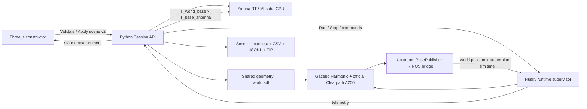

# Технічна документація

## Архітектура



Радіопоширення не реалізоване самостійно. Інтеграційний код викликає
Sionna PathSolver. Gazebo/ROS пакети й фізичний Husky — офіційні Clearpath.
Scene v2 — єдине джерело геометрії й параметрів для UI, Mitsuba та SDF.

## Модулі

| Модуль | Відповідальність |
| --- | --- |
| `app/scenario.py` | Normalization/validation, v1 migration, presets, quaternion transforms |
| `app/radio.py` | Official Sionna backend; rotated box meshes; SDF; legacy CLI/API |
| `app/builder.py` | HTTP/static frontend, active scene/revision, lifecycle, sampler, grid jobs |
| `app/datasets.py` | Dataset writer, snapshot/hash, CSV/JSONL, metadata, ZIP |
| `app/husky_runtime.py` | ROS node, owned process groups, deadman, world-pose telemetry |
| `app/missions.py` | 5 сімейств × 2 Tx, deliberate shadow goals та LOS-діагностика |
| `app/campaigns.py` | Bounded worker pool, full/paired, source reuse, resume, всі результати/ZIP |
| `app/runtime_pool.py` | Owned Gazebo/ROS процеси, окремі domain/partition/runtime directories |
| `frontend/src/mission-view.js` | Original COLLADA materials, actual pose/joints, Rx, causal layers/reference overlay |
| `launch/husky.launch.py` | ros_gz_sim, clock/world-pose bridges, official robot spawn |
| `config/pose_publisher.urdf.xacro` | Supported Clearpath extras hook for upstream Gazebo PosePublisher |
| `scripts/prepare_robot.py` | Local generated Clearpath config; dynamic absolute extras path |
| `scripts/prepare_husky_assets.py` | Official URDF visual transforms/STL meshes and provenance |
| `frontend/src/main.js` | Three.js viewport, gizmos, property editor, control, dataset UI |
| `frontend/src/style.css` | Responsive constructor layout |

Compose використовує LOCAL_UID/LOCAL_GID (default 1000:1000). Run script
зберігає host IDs у новий .env, не перезаписуючи існуючий. Runtime/дані мають
бути доступні цьому власнику; старі root-owned файли потребують міграції прав.
ROS_LOG_DIR та GZ_HOMEDIR перенесені в writable /tmp контейнера.

Frontend dependencies locked in `frontend/package-lock.json`; install with
`npm ci`. Radio dependency pinned to Sionna RT 2.2.0 in requirements-radio.txt;
transitive versions are recorded in each dataset manifest. ROS image base/tag
and apt packages are upstream references, not fully immutable version locks.

## Scene v2

```json
{
  "version": 2,
  "name": "Example",
  "objects": [{
    "id": "wall-1", "label": "Wall", "center": [0, 4, 1.5],
    "size": [8, 0.2, 3], "yaw_rad": 0,
    "material": "concrete", "thickness_m": 0.2
  }],
  "tx": {"position": [-2, 2, 1.5], "orientation_rad": [0, 0, 0]},
  "rx": {
    "mode": "husky", "position": [2, 2, 1.2], "orientation_rad": [0, 0, 0],
    "mount_position": [0, 0, 1], "mount_orientation_rad": [0, 0, 0]
  },
  "robot": {"position": [0, -2, 0.3], "yaw_rad": 1.57079632679},
  "radio": {
    "frequency_hz": 2400000000, "tx_power_dbm": 20,
    "bandwidth_hz": 20000000, "noise_figure_db": 5, "period_s": 1,
    "solver": {"max_depth": 3, "samples_per_src": 10000,
               "max_num_paths_per_src": 10000, "seed": 42}
  }
}
```

Приклад схеми, не готова кімната: для robot physics додайте підлогу.
Defaults та завершені сцени — config/scenario.json, empty.json, room.json,
corridor.json. Об'єкти — boxes із поворотом навколо Z. Повні roll/pitch стін
і mesh/CAD import не реалізовані. Двері представлені окремими сегментами.

IDs унікальні, без `/` або пробілів; tx/rx/robot зарезервовані. Максимум
100 геометричних об'єктів. Розміри: 0.01..1000 м; всі координати скінченні.
Матеріали: concrete, brick, plasterboard, wood, glass, metal.
Бюджет solver обмежений: depth 0..8, samples/path limit 100..1000000;
seed — ціле 0..2147483647. Grid окремо обмежений 2500 точками.

## Координати та геометрія

World: правобічна, Z-up, метри. Орієнтація антен — [yaw,pitch,roll]
у радіанах, композиція Rz(yaw) Ry(pitch) Rx(roll). Quaternion — [x,y,z,w].
Three.js camera/grid налаштовані під Z-up; geometry rotation не є лише UI-ефектом:
write_box повертає вершини Mitsuba, SDF записує ту саму yaw у pose.

Поза Husky походить із власного upstream Gazebo PosePublisher, доданого
через підтримуваний Clearpath URDF extras, і ros_gz_bridge. Стандартний
SceneBroadcaster pose/info не використовується для ідентифікації: його
Pose_V → TFMessage може втрачати імена/час кадрів. Іменований pose topic
`/husky/world_pose` моститься у `/simulation/poses`; runtime вибирає
`child_frame_id == a200_0000/robot`.

Поза model — world pose root/base_link офіційного URDF. Mounted antenna:

`T_world_antenna = T_world_base × T_base_antenna`

Немає ручного додавання spawn до odometry. Odometry використовується для
швидкостей, які мають body frame. Radio result містить позу/час, захоплені
до обчислення; solver latency не перетворюється на переміщення антени.

## Стан, Apply та процеси

Активний canonical scene/revision зберігається у `.runtime/active_scene.json`.
Сцена SDF — `.runtime/world.sdf`. UI draft незалежний від активної сцени.
Apply валідує, зупиняє старий Husky при потребі, готує Radio й SDF,
активує revision та скидає старі pose/measurement/job. Невалідна сцена
не замінює активну. Apply заборонений під час recording/grid.

Single-worker executor серіалізує створення/запити до RadioWorker. Кожна
Sionna-сцена виконується у власному процесі (`app/engine.py`), створюється,
використовується й звільняється на його головному потоці. Native/JIT
стан не переноситься між сценами; IPC містить лише plain-data результати.
Native crash повертає помилку, не завершує HTTP backend. HTTP server має кілька потоків;
довгий grid працює фоново, UI polling залишається доступним. Окремі
operation/state locks захищають Apply/Start/Record і ревізії.

Run запускає тільки власний ros2 launch process group. Stop завершує цю
групу SIGINT → при timeout SIGTERM → SIGKILL; сторонні ROS/Gazebo процеси
не чіпає. Start не допускається під час запису/grid. Після запуску
state=starting, актуальна telemetry переводить у running. Pose старіша
за 3 с позначається stale; mounted sample без свіжої pose відхиляється.
Telemetry іншої revision або зупиненої симуляції відхиляється.

Команди линійної/кутової швидкості: ±1 m/s та ±1.5 rad/s. Runtime публікує
TwistStamped у platform/cmd_vel з ROS sim timestamp; lease 0.5 с реального
часу, без heartbeat — нуль. Browser control sends while held; Stop simulation
і brake movement — різні дії.

## API конструктора

JSON requests/response, той самий origin, до 1 MiB POST. Значення нижче
належать реалізованому API, а не майбутньому плану.

| Метод/шлях | Тіло / результат |
| --- | --- |
| GET `/health` | status, backend, builder=true |
| GET `/api/state` | scenario, revision, robot_status/pose, measurement, recording, job, error |
| GET `/api/preset/empty`, `/room`, `/corridor` | Canonical scene |
| POST `/api/validate` | Scene → normalized scene без Apply |
| POST `/api/scene` | Scene → revision + scenario |
| POST `/api/sample` | `{}` → поточний configured Rx |
| POST `/sample` | `{position_m:[x,y,z]}` → explicit position, compatibility |
| POST `/api/robot/start` | `{}` → starting |
| POST `/api/robot/stop` | `{}` → stopped, active recording finishes |
| POST `/api/robot/control` | `{linear:0.3,angular:0}` |
| POST `/api/record/start`, `/stop` | `{}` → manifest |
| POST `/api/grid/start` | `{min:[...],max:[...],step:[...]}` → async job |
| POST `/api/grid/cancel` | `{}` → cancellation request |
| GET `/api/datasets` | All manifests, newest first |
| GET `/api/datasets/<id>.zip` | Completed/partial archive |
| POST `/api/robot/telemetry` | Internal runtime pose/revision/velocities; last measurement returned |
| GET `/assets/husky/model.json` | Prepared official visual asset descriptors |

Errors: 400 invalid request/state, 404 missing route/file/dataset, 500
unexpected backend failure. Grid/record are one active collection per process.
Cancellation may wait for one current ray-tracing call. No auth/multiuser
isolation, no concurrent experiment sessions; deploy behind access control
if remote/shared. Constructor bound to loopback through compose by default.

Internal runtime HTTP port 8766 has GET health and POST start/stop/control.
It is not a browser API. Backend connects using HUSKY_URL (default
http://husky:8766); runtime reports to RADIO_URL (http://radio:8000).
Internal requests bypass external HTTP proxy; external package networking
and TLS verification are preserved. Docker socket is not mounted in application containers.

## Physics and calibration

Sionna RT uses isotropic single-element vertical-polarization arrays,
reflection/refraction/diffraction, finite-depth stochastic path search.
Nonzero complex CIR coefficients are summed coherently for narrowband gain.
Absolute path delays retained via normalize_delays=False.

RSSI = Tx power + 10 log10(gain). SNR uses -174 dBm/Hz thermal density,
bandwidth and noise figure. This is not a concrete modem demodulation model.
There is no other-transmitter interference, packet loss/latency, receiver
measurement noise. Automatic RSSI-proxy recovery through GPR/Nav2 is described
in [EXPERIMENT_GUIDE.md](EXPERIMENT_GUIDE.md); its API/event format is in
[EXPERIMENT_FORMAT.md](EXPERIMENT_FORMAT.md). It uses Gazebo ground-truth
localization and a static costmap, not packet reception or SLAM.

ITU material thickness models a slab at the intersected surface. A closed
box has multiple faces; it is not a volumetric Maxwell solver for solid
walls. Ground/building/material calibration and convergence checks are
required before accuracy claims. The robot body does not shadow/scatter
radio rays; only configured objects are traced. Geometry and radio
properties are static during a running experiment.

## Build, checks and troubleshooting

Host constructor only (static Rx/grid, no robot required):

```bash
bash scripts/setup_constructor.sh
.venv/bin/python app/builder.py --port 8010
```

Full stack: scripts/run_demo.sh. Existing prepared images:
`docker compose up -d --no-build`. Node is needed for frontend build, not
for serving it; static frontend/dist is bind-mounted like application code.

Checks mutate the demo scene; run them sequentially with no active dataset:

```bash
.venv/bin/python -m unittest discover -s tests -v
python scripts/check_api.py
python scripts/check_constructor_integration.py
npm --prefix frontend run test:e2e
```

Playwright configuration uses /usr/bin/chromium by default. Set
PLAYWRIGHT_CHROMIUM_PATH to another installed Chromium. It uses software
WebGL in the test container; the browser workflow itself uses normal WebGL.
The integration script applies room + Husky-mounted Rx and drives the robot.
The browser test applies room + static Rx, collects a small grid and downloads ZIP.
Do not run them concurrently against one Session.

- API unavailable: check containers and port mapping. Wait for initialization.
- Visual assets missing: startup husky logs, prepare_husky_assets.py; files in
  .runtime/assets/husky. Provenance/license metadata in NOTICE.json/model.json.
- Starting/stale pose: .runtime/husky.log, PosePublisher and /simulation/poses.
- No movement: active controllers, use_sim_time, command lease, collisions/spawn.
- Empty/null radio: device inside solid or no paths within solver budget;
  inspect events and CIR, increase budget on a small representative region.
- 403 packages: required domains/network settings. Do not disable signatures/TLS.
- TLS certificate failure during radio image build: trusted CA via RADIO_CA_BUNDLE.
- Full disk: Docker vfs copies complete filesystems. Stop/remove only your
  obsolete containers/build artifacts; scripts do not prune unrelated resources.
- Browser does not support WebGL: use a current Chromium/Firefox with a working GPU
  or software renderer. This is a browser viewport, not a streamed Gazebo desktop.

Cloud publication retains files, not live processes/connections. Recheck Docker
images/runtime and restart services in each restored environment. Each cloud task
already has an isolated checkout; no extra Git worktree is needed unless requested.
