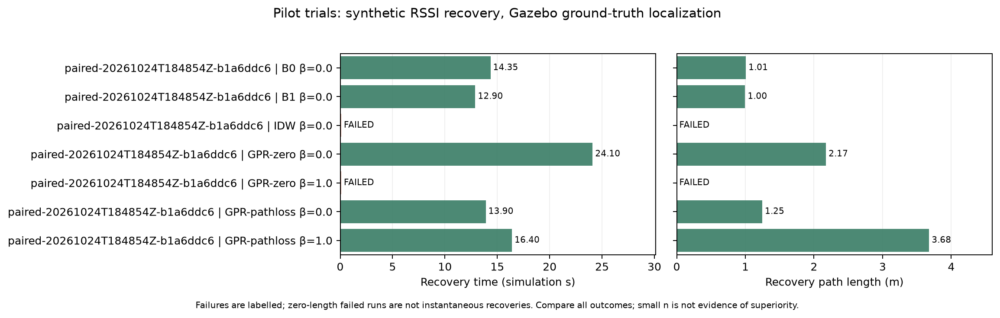

# Перевірені пілотні експерименти, не тренувальний benchmark

`paired-pilot/` містить реальні Gazebo/Nav2/Sionna результати перевірки
24 жовтня 2026 року. Це один recovery checkpoint кімнати, 7 конфігурацій,
по одному запуску. Вони не доводять статистичної переваги методу.

- `source.zip` — повний вихідний B1-проїзд із деградацією та відновленням.
- 7 ZIP із назвами experiment_id — парні recovery, що починалися зі спокою
  в одному loss checkpoint та **10 однакових** вимірювань до втрати.
- `reference.zip` — окремий grid, 49 точок на висоті 0.83 м; контролер його не бачив.
- `trials.csv`, `report.json` — усі успіхи й невдачі, час і шлях.
- `maps.csv` — однаковий causal prefix на t=11.95 s; 43 spatial holdout
  точки на відстані >=1 м від усіх доступних observations. Після spatial
  thinning навчальними стали лише 4 точки, тому якість GPR тут низька.

| Метод | β | Статус | Час recovery, sim s | Шлях recovery, m |
| --- | --- | --- | ---: | ---: |
| B0 | 0 | RECOVERED_WAIT | 14.35 | 1.008 |
| B1 | 0 | RECOVERED_WAIT | 12.90 | 0.996 |
| IDW | 0 | FAILED | 0.10 | 0.000 |
| GPR-zero | 0 | RECOVERED_WAIT | 24.10 | 2.175 |
| GPR-zero | 1 | FAILED | 0.10 | 0.000 |
| GPR-pathloss | 0 | RECOVERED_WAIT | 13.90 | 1.246 |
| GPR-pathloss | 1 | RECOVERED_WAIT | 16.40 | 3.678 |

Більше β не гарантує успіху: conservative GPR-zero не знайшов кандидата.
У кожного методу перше рішення використовує точно ті самі 10 observations;
нові вимірювання логуються, але допускаються до моделі лише після першої цілі.
Усі сім запусків мають однакові implementation/config hashes. Для повторного
доїзду використано xy_goal_tolerance=0.03 м, yaw=0.05 rad; параметри збережені
в manifests. Невдалі короткі запуски не є миттєвим відновленням. Малий n
та низька якість прогнозу не дають підстав заявляти перевагу методу.

Перегляд на своїй інсталяції:

```bash
python3 scripts/load_example_runs.py
```

Після запуску backend відкрити `/experiments.html`, оновити список і вибрати
запуск → Відтворити. Імпортер не перезаписує інші локальні дані. Архіви
містять scene, versions, CIR та часові рішення; живої ROS-сесії в них немає.
Reference вибирається окремо і доступний лише для оцінювання/візуалізації.

Повторний аналіз:

```bash
.venv/bin/python scripts/evaluate_radio_maps.py \
  examples/experiments/paired-pilot/source.zip \
  examples/experiments/paired-pilot/reference.zip --at 11.95 --min-distance 1
```

Детальні обмеження й протокол — [EXPERIMENT_GUIDE](../../docs/EXPERIMENT_GUIDE.md).



## П’ять світів, два положення Tx

`world-pilot/` містить ще 10 реальних запусків B1: room, corridor, warehouse,
courtyard та empty, по два Tx layouts. У 9 випадках RSSI відновився;
corridor-b завершився FAILED без хорошої досяжної історичної точки.
На складі повні траєкторії становили приблизно 18 м; в empty-a — 25.2 м.
Це пілот працездатності, не незалежний test benchmark. Усі ZIP, помилки
та метрики збережені у trials.csv та report.json.

```bash
python3 scripts/load_example_runs.py --source examples/experiments/world-pilot
```

Параметри Nav2 цієї серії збережені у navigation.yaml. Нові manifests
також записують YAML, implementation/config hashes та compiler settings;
у ранніх пілотних ZIP ці optional поля можуть бути відсутні.
