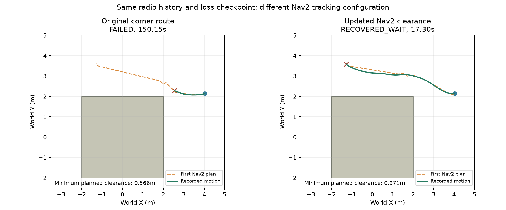
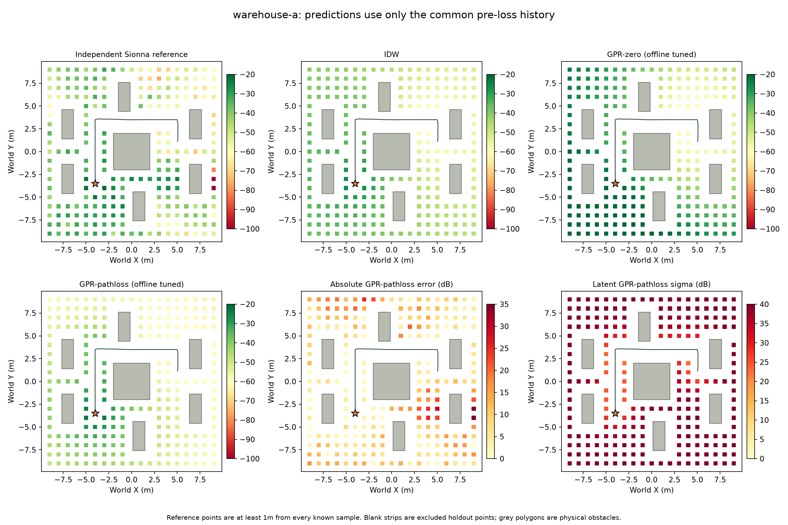
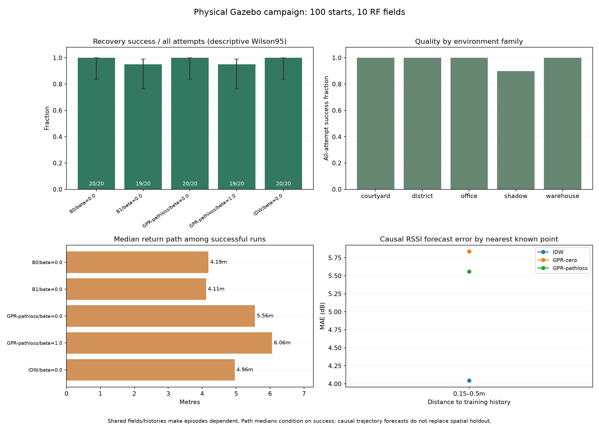

# Перевірені радіотіні, фізичні повернення та незалежні карти

25 жовтня 2026. **150 фізичних recovery-епізодів у Gazebo**, 10 спільних повних
вихідних місій, 5 геометрій × 2 Tx. Приймач закріплений на офіційному Clearpath
Husky A200. Sionna RT обчислює канал; Nav2 керує рухом. Це симуляційний RSSI proxy.

[Відео повної демонстрації](demo.mp4) · [Журнал цієї демонстрації](demo.zip) ·
[Повний inventory](inventory.csv) · [Машиночитані підсумки](summary.json) · [SHA256](checksums.sha256).

## Що зібрано

| Серія | Фізичних стартів | Успіхів | Медіана recovery, sim s* | Медіана шляху, m* | Код |
| --- | ---: | ---: | ---: | ---: | --- |
| [Базова](baseline-100.zip): B0/B1/IDW/GPR-pathloss β0/β1, два повтори | 100 | 98 | 14.725 | 4.999 | `e85ca09` |
| [GPR noise=8](gpr-tuned-20.zip): профіль, обраний за spatial validation | 20 | 18 | 14.625 | 5.239 | `e85ca09` |
| [Після виправлення Nav2](navigation-30.zip): B1/GPR-pathloss β0/β1 | 30 | 30 | 15.525 | 5.602 | `103767a` |

\* Час/шлях наведені серед успішних повернень. Усі таймаути збережені у ZIP,
CSV і знаменниках частки успіху. Не слід вважати короткий невдалий рух швидким
поверненням. Остання серія має один повтор кожної конфігурації/умови.

Це **парні фізичні повернення зі спокою**, а не 150 повних виїздів від бази.
Десять повних вихідних місій є в `sources/` кожного архіву; їх рахують один раз.
Спільні seed-вимірювання обмежені моментом втрати й не рахуються як нові дані.

- 6 380 нових вимірювань під час повернень;
- 1 228 вимірювань у десяти вихідних повних місіях;
- 7 356 незалежних reference-позицій на висотах 0.83228 / 1.2 / 1.8m;
- **14 964 записи без дублювання seed-історій**, з них 9 reference-позицій
  мають RSSI=null: розв’язувач не знайшов шляхів. Їх не підмінено нульовим RSSI.

Окрема повна браузерна демонстрація в `demo.zip` не включена в ці кількості.
Її ID — у [demo-id.txt](demo-id.txt). Діагностичні перервані/некоректні пілоти
винесені у [diagnostics/](diagnostics/) та не включені в benchmark.

Додаткова повна **GPR**-демонстрація з живою 3D-картою RSSI:
[gpr-demo.zip](gpr-demo.zip), [метрики](gpr-demo-verification.json),
ID — [gpr-demo-id.txt](gpr-demo-id.txt). 113 показів, NLOS loss,
відновлення за 17.10 sim s / 6.65 m, без operator interventions.
Це окрема acceptance перевірка, поза 150 парними recovery та їхніми підсумками.

## Відтворити у своєму інтерфейсі

Швидкий перегляд без імпорту: **http://127.0.0.1:8010/research.html** після
запуску сервісів. Є графіки GPR за префіксами збереженої історії,
відкладені test-метрики та прямі посилання на архівні 3D-проїзди.
[Протокол і керування](../../../docs/MODEL_EVIDENCE.md).
`learning-evidence.json` — додане повторне обчислення train/validation
префіксів, не нові RF-покази чи нові епізоди. Кількості корпусу не змінені.

Після `bash scripts/run_demo.sh`:

```bash
python3 scripts/load_example_runs.py --source examples/experiments/shadow-benchmark
```

Відкрити **http://127.0.0.1:8010/experiments.html → Записи**. Пошук працює за
сценою, методом або ID. Для повного виїзду оберіть ID із `demo-id.txt` або
запис `source-…`. Для порівняння методів — звичайний `shadow-a`, `office-b` тощо.
Повзунок показує доступні на той момент вимірювання, карту, ціль і шлях.
Еталонне поле вмикається окремо та позначене **ЕТАЛОН ПІСЛЯ ЕКСПЕРИМЕНТУ**.
Імпорт/replay не запускає рух і не додає reference до контролера.

Імпортер не перезаписує інші локальні дані; однакові source ZIP пропускає.
Він відновлює також campaign metadata для повторного використання checkpoint.
JSON/CSV/версії/сцени/часові рішення є всередині архівів; живої ROS-сесії в них немає.

Нову збалансовану серію з поточним Nav2 можна запустити у вкладці **Серія
експериментів**: 100 епізодів, рекомендований набір, paired, два воркери. Або:

```bash
python3 scripts/run_experiments.py --runs 100 --workers 2 --protocol paired \
  --methods B0 B1 IDW GPR-pathloss --betas 0 1 \
  --history-source-campaign 20261025T085813Z-c98fac62 \
  --output .runtime/reports/new-run
```

Для нових повних виїздів використовуйте `--protocol full` без history-source.
Старі результати зберігають свої implementation/nav-config hashes; для їх точної
конфігурації потрібна вказана ревізія коду. Поточний main містить виправлену навігацію.

## Що показали перевірки

**Фізичне екранування перевіряється до збору.** П’ять проб навколо кожної цілі
показали запас 9–24dB нижче порога −47dBm у зафіксованому RF-бюджеті. Ці
oracle-проби не потрапляють до навчальної історії. Одна геометрично закрита
позиція може мати різний сигнал у різних світах через відбиття.
[Дані перевірки](mission-preflight.json).

**β змінив якість обраної цілі.** Точний незалежний Sionna-запит у першій цілі,
а не наближена сусідня grid-точка, дав:

| Метод у базовій серії | Фактично добрих перших цілей |
| --- | ---: |
| B0 | 20/20 |
| B1 | 20/20 |
| IDW | 12/20 |
| GPR-pathloss β=0 | 16/20 |
| GPR-pathloss β=1 | 20/20 |

Це повтори в 10 полях зі спільною історією. Небезпечна перша ціль не обов’язково
означає невдалу місію: зв’язок може відновитися дорогою або після replanning.
[Повна перевірка цілей](baseline-100-targets.json).

**Краща карта не гарантує кращий рух.** Offline-профіль GPR підібрано на
train/validation, а потім фізично перевірено у 20 епізодах. Він дав 18/20,
тому baseline не замінено лише за похибкою карти. Парне порівняння не довело
покращення: [результат](profile-comparison.json).

**Виявлено й виправлено проблему кута.** Обидва базові таймаути сталися у
`shadow-a`. У контрольній B1-парі мінімальна відстань першого Nav2-шляху від
перешкоди змінилася з 0.566m до 0.971m; при налаштованому радіусі 0.55m це
збільшення запасу з 1.6cm до 42.1cm. Змінені inflation radius, lookahead і
регулювання швидкості біля перешкод. Та сама історія/точка втрати:
таймаут 150.15s → успішне повернення 17.30s.
[Числа](navigation-corner-clearance.json) · [парне порівняння](navigation-comparison.json).



**Підготовка стала швидшою.** У базовій серії median readiness:
11.15s cold проти 2.16s warm, 10/90 запусків відповідно. Це приблизно
5.2× для підготовки, а не для всієї симуляції. Серія 100 на двох воркерах
тривала 1 405s у хмарному середовищі з CPU quota 4 cores. Це опис цього
запуску, не гарантія часу на іншій машині.

## Просторова якість карти

Тільки результати, доступні до втрати, навчають модель; reference віддалений
принаймні на 1m від усіх відомих позицій. Профілі обиралися на шести train
полях та двох validation; окремо оцінено два courtyard test поля, 621 позиція.

| Профіль після offline підбору | Macro MAE на test, dB |
| --- | ---: |
| IDW | 9.55 |
| GPR-zero | 14.49 |
| GPR-pathloss | 7.25 |

[Параметри, RMSE/NLPD/coverage та відстані](map-study.json) · [CSV](map-scores.csv).
Усі noise/kernel налаштування записані; ці числа не є абсолютною похибкою
фізичного радіоканалу. Звіт [baseline-100-analysis.json](baseline-100-analysis.json)
окремо показує causal forecast за близькістю до попередніх показів та відстань
повернення до відомої доброї точки (медіана 0.386m у базовій серії).



## Практичні межі

Wilson95 для 98/100: [0.930, 0.9945], для 30/30: [0.8865, 1.000]. Це описові
інтервали: повтори в тих самих полях/історіях залежні й не доводять універсальну
якість у нових середовищах. Після цього аналізу test-світи є відомим benchmark;
для нового твердження про узагальнення потрібні нові геометрії.

Чутливість до 40k променів, depth=5 та іншого чисельного seed дала максимальну
зміну RSSI 19.59dB серед 80 проб. Усі перевірені центри радіотіні лишилися нижче
порога, але глобальну збіжність фізики цим не доведено.
[Повні convergence-проби](convergence.json). Benchmark і reference використовують
зафіксовані depth=3 / 10k rays; їх не підмінено пізнішими налаштуваннями.

Статичні перешкоди, ground-truth localization, coherent narrowband RSSI;
немає packet PHY, SLAM, RF-корпусу робота або hardware validation.
Подальші ітерації та відтворення оцінок: [QUALITY.md](../../../docs/QUALITY.md).


